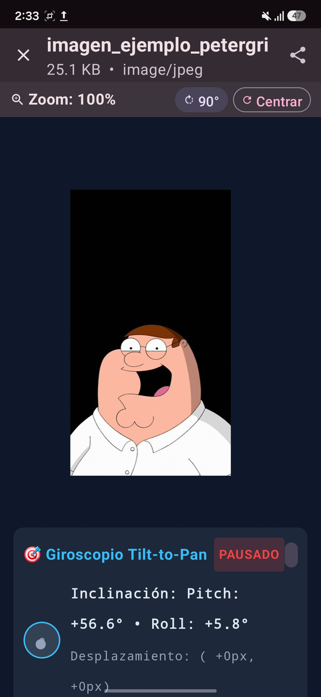
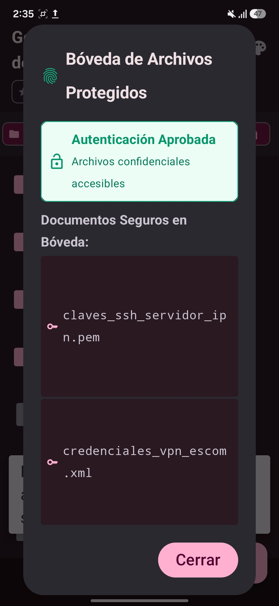
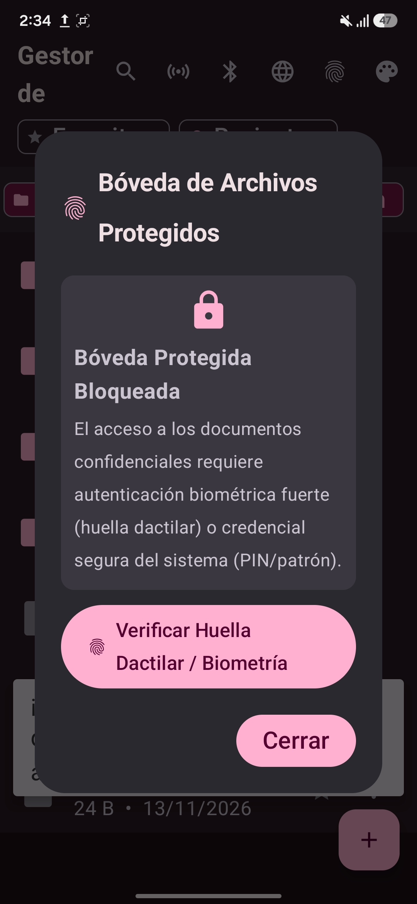
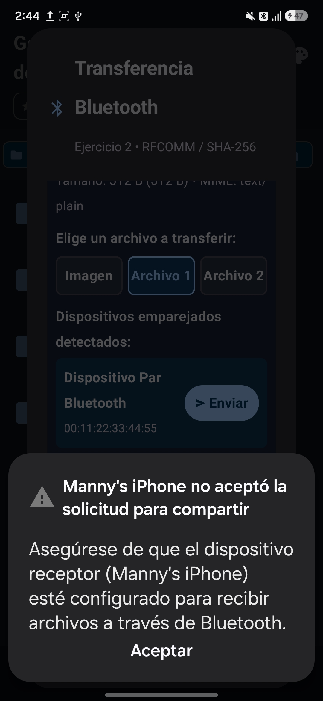
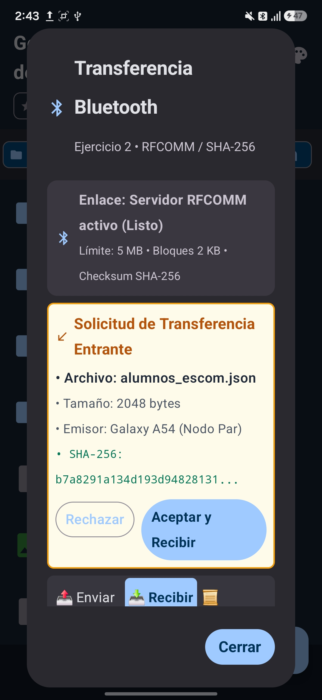
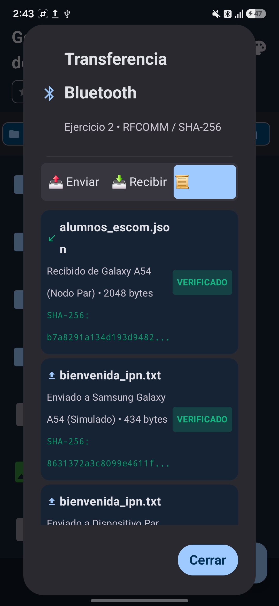
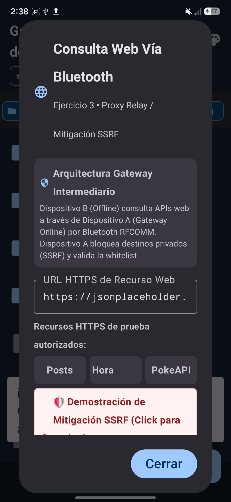
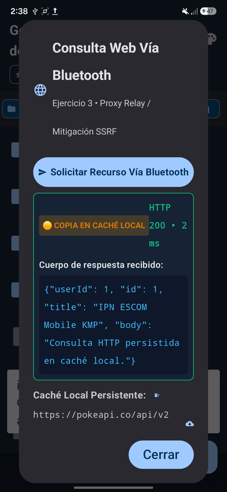
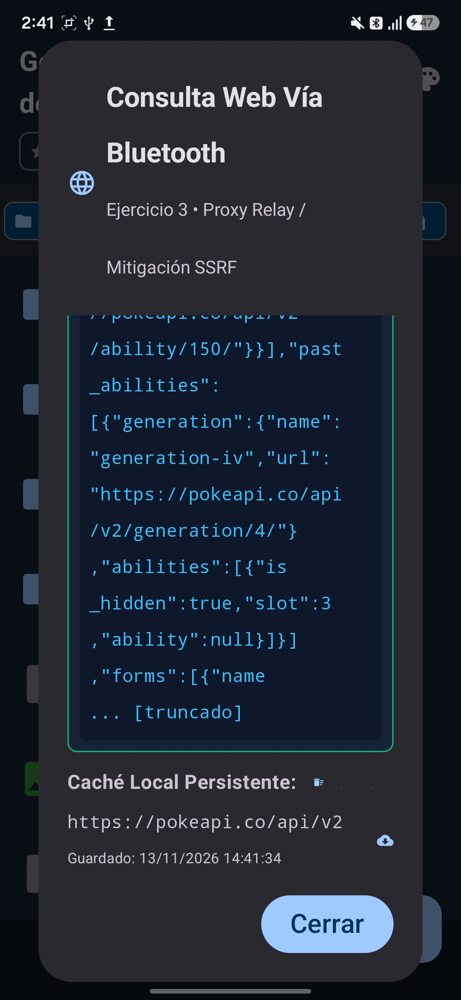
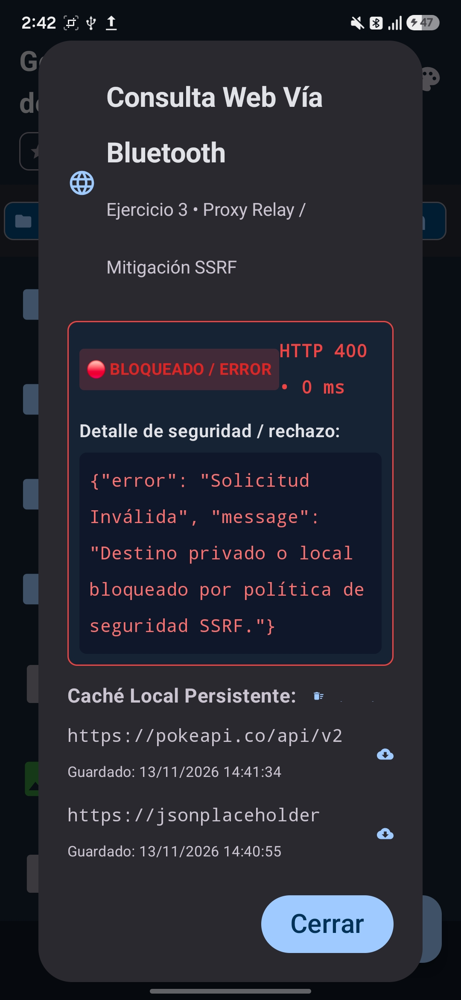

<div align="center">

# INSTITUTO POLITÉCNICO NACIONAL
### ESCUELA SUPERIOR DE CÓMPUTO

<br/>

## **Desarrollo de Aplicaciones Móviles Nativas**
### **Práctica 6: Manejo de sensores del dispositivo móvil**
#### **Kotlin Multiplatform (KMP) + Jetpack Compose + Sensores de Hardware + Bluetooth RFCOMM P2P**

---

**Profesor:** M. en C. Gabriel Hurtado Avilés  
**Grupo:** 7CV4 &nbsp;|&nbsp; **Semestre:** 2027-1  
**Ciclo Escolar:** 2027-1  

---

### **Alumno**

| Nombre Completo | Boleta |
| :--- | :---: |
| **Aragón Martínez Manuel Alejandro** | 2023630411 |

<br/>

**Ciudad de México, Noviembre de 2026**

---

</div>

<br/>

## 📑 Índice de Contenidos
1. [Resumen Ejecutivo y Alcance](#-resumen-ejecutivo-y-alcance)
2. [Arquitectura y Estructura Multiplataforma (KMP)](#-arquitectura-y-estructura-multiplataforma-kmp)
3. [Ejercicio 1: Sensores e Interacción (Parte 1 - Gestor de Archivos)](#-ejercicio-1-sensores-e-interacción)
4. [Ejercicio 2: Transferencia de Archivos por Bluetooth (Parte 1)](#-ejercicio-2-transferencia-de-archivos-por-bluetooth)
5. [Ejercicio 3: Consulta Web vía Proxy Relay Bluetooth (Parte 1)](#-ejercicio-3-consulta-web-vía-proxy-relay-bluetooth)
6. [Videojuego Ciberduelo Bluetooth 1v1 y Sensores (Parte 2 - Cyber Breach)](#-videojuego-ciberduelo-bluetooth-1v1-y-sensores)
7. [Matriz Exhaustiva de Pruebas y Aseguramiento de Calidad (QA)](#-matriz-exhaustiva-de-pruebas-qa)
8. [Guía de Evidencias y Capturas para Samsung Galaxy A54](#-guía-de-evidencias-y-capturas)
9. [Instrucciones de Compilación y Ejecución](#-instrucciones-de-compilación-y-ejecución)
10. [Conclusiones Técnicas y Referencias APA](#-conclusiones-técnicas-y-referencias-apa)

---

## 📋 Resumen Ejecutivo y Alcance

La **Práctica 6** extiende integralmente las dos aplicaciones desarrolladas en la Práctica 4 (Gestor de Archivos Multiplataforma y Videojuego Táctico Cyber Breach / Net Strike), incorporando capacidades avanzadas de hardware nativo:
- **Sensores Físicos:** Lectura y procesamiento en tiempo real de **Acelerómetro** y **Giroscopio**, detección de agitación (*shake gesture*), navegación panorámica de imágenes por inclinación (*tilt-to-pan*), retícula cinética de apuntado en cuadrícula de 8×8 y recarga de energía cinética con temporizador de enfriamiento.
- **Autenticación Biométrica:** Protección de bóveda confidencial mediante **BiometricPrompt API** (Android API 24+) y `LocalAuthentication` (iOS), admitiendo huella dactilar, biometría facial y credencial de bloqueo de pantalla.
- **Comunicaciones Inalámbricas Bluetooth RFCOMM P2P (100% Offline):**
  1. *Transferencia Confiable de Archivos:* Protocolo fragmentado en paquetes de 4 KB con Stop-and-Wait ACK, cálculo y verificación criptográfica de hash **SHA-256**, archivo temporal `.tmp` con renombrado atómico y catálogo de historial con estados.
  2. *Proxy Web Relay:* Arquitectura Pasarela-Visor donde un dispositivo conectado a Internet atiende consultas HTTP de un visor sin conexión a través de un canal seguro RFCOMM, mitigando vulnerabilidades SSRF con lista blanca y fallback a caché local.
  3. *Combate Multijugador Sincronizado 1v1:* Duelo en tiempo real entre dos terminales conectadas por Bluetooth, alternancia estricta de turnos, numeración de secuencia (`seq`) contra duplicados y detección inmediata de desconexión sin corrupción de memoria.
- **Directrices Institucionales:** Soporte estricto de colores institucionales (**Guinda IPN** `#6C1D45` y **Azul ESCOM** `#003366`), arquitectura desacoplada (*Clean Architecture*), compatibilidad KMP para Android API 24+ e iOS 15+, y funcionamiento autónomo sin requerir servicios en la nube ni conexión externa obligatoria.

---

## 🏛 Arquitectura y Estructura Multiplataforma (KMP)

El proyecto se estructura bajo el patrón de **Arquitectura Limpia (Clean Architecture)** con MVI/MVVM y flujo de datos unidireccional (*Unidirectional Data Flow*):

```
practica4_Moviles/
├── parte1_gestor_archivos/
│   ├── shared/
│   │   ├── src/commonMain/kotlin/com/escom/ipn/p4/filemanager/
│   │   │   ├── model/ (SensorModels, BiometricModels, BluetoothModels, HttpProxyModels)
│   │   │   ├── service/ (BluetoothProtocolService, ISensorManager, IBluetoothTransferService, Sha256Util)
│   │   │   └── viewmodel/ (FileManagerViewModel)
│   │   ├── src/androidMain/kotlin/com/escom/ipn/p4/filemanager/service/
│   │   │   ├── AndroidSensorManager.kt
│   │   │   ├── AndroidBiometricAuthService.kt
│   │   │   ├── AndroidBluetoothService.kt
│   │   │   └── Sha256Util.android.kt
│   │   └── src/iosMain/kotlin/com/escom/ipn/p4/filemanager/service/ (Stubs iOS CoreMotion & LocalAuth)
│   └── androidApp/src/main/kotlin/com/escom/ipn/p4/filemanager/
│       ├── MainActivity.kt (FragmentActivity con ciclo de vida onPause/onResume)
│       └── ui/components/
│           ├── SensorTelemetryDialog.kt
│           ├── BluetoothTransferDialog.kt
│           ├── WebProxyDialog.kt
│           ├── BiometricVaultDialog.kt
│           └── FileViewerSheet.kt (Tilt-to-pan con giroscopio)
└── parte2_cyber_breach/
    ├── shared/
    │   ├── src/commonMain/kotlin/com/escom/ipn/p4/cyberbreach/
    │   │   ├── model/ (CyberBreachModels, CyberBreachPacket, IGameSensorManager)
    │   │   ├── service/ (GameEngine, IBluetoothGameService)
    │   │   └── viewmodel/ (CyberBreachViewModel)
    │   ├── src/androidMain/kotlin/com/escom/ipn/p4/cyberbreach/service/
    │   │   ├── AndroidGameSensorManager.kt (Tilt aiming & Kinetic shake)
    │   │   └── AndroidBluetoothGameService.kt (RFCOMM 1v1 Sync)
    │   └── src/iosMain/kotlin/com/escom/ipn/p4/cyberbreach/service/
    └── androidApp/src/main/kotlin/com/escom/ipn/p4/cyberbreach/
        ├── MainActivity.kt
        └── ui/
            ├── CyberBreachScreen.kt (HUD Bluetooth y controles de sensores)
            ├── components/
            │   ├── CyberGrid.kt (Mira de apuntado cinético)
            │   ├── BluetoothLobbyDialog.kt
            │   └── PlayerDefenseGrid.kt
            └── screens/TitleMenuScreen.kt
```

---

## 📱 Ejercicio 1: Sensores e Interacción

### 1. Telemetría de Acelerómetro y Giroscopio
- **Acelerómetro:** Mide la aceleración propia del dispositivo en los 3 ejes ($a_x, a_y, a_z$) en $m/s^2$, permitiendo detectar la orientación con respecto al campo gravitatorio terrestre ($g \approx 9.81\text{ }m/s^2$).
- **Giroscopio:** Registra la velocidad angular $(\omega_x, \omega_y, \omega_z)$ en radianes por segundo ($rad/s$), calculando la velocidad de rotación y torsión.
- **Gestión del Ciclo de Vida y Ahorro de Batería:**
  En cumplimiento estricto con las directrices de Android y la especificación de la práctica:
  - Al pasar la aplicación a segundo plano (`onPause`), se invoca de inmediato `sensorManager.unregisterListener(this)`, suspendiendo el muestreo de hardware y evitando el drenado involuntario de batería.
  - Al regresar a primer plano (`onResume`), los sensores se registran nuevamente con `SENSOR_DELAY_UI` o `SENSOR_DELAY_GAME`.
- **Modo Simulado / Pruebas:**
  El diálogo modal `SensorTelemetryDialog` incluye conmutador de simulación y botones de inyección de valores para QA sin necesidad de agitar físicamente el equipo en entornos CI/CD o emuladores de escritorio.

### 2. Detección de Agitación (*Shake Detection*)
El algoritmo implementado evalúa la fuerza $g$ instantánea calculada como:
$$g_{\text{force}} = \frac{\sqrt{a_x^2 + a_y^2 + a_z^2}}{g_{\text{earth}}}$$
Si $g_{\text{force}} > 2.2$ y ha transcurrido un periodo de enfriamiento (*debouncing*) de al menos $800\text{ ms}$, se dispara un evento hápitco y la acción contextual asociada (ej. ordenamiento aleatorio de lista o reseteo de vista).

### 3. Desplazamiento Panorámico por Inclinación (*Tilt-to-Pan*)
En el visor integrado de imágenes (`FileViewerSheet`), la inclinación física del dispositivo (pitch y roll) traslada dinámicamente las coordenadas del lienzo $(x, y)$, permitiendo inspeccionar imágenes en alta resolución con movimiento natural sin necesidad de deslizar el dedo.

### 4. Bóveda Protegida por Biometría (*Biometric Vault*)
Protección de documentos confidenciales mediante `BiometricPrompt` de AndroidX:
- Admite autenticación fuerte (`BIOMETRIC_STRONG`) y credencial de respaldo (`DEVICE_CREDENTIAL`: PIN, patrón o contraseña).
- Bloqueo en memoria: Los archivos de la bóveda sólo se descifran y listan tras un resultado exitoso de la API biométrica nativa del sistema.

---

## 📡 Ejercicio 2: Transferencia de Archivos por Bluetooth

El módulo de transferencia Bluetooth permite compartir documentos `.txt`, `.xml`, `.json` e imágenes `.jpg` directamente entre dos dispositivos móviles mediante un canal RFCOMM con UUID `fa87c0d0-afac-11de-8a39-0800200c9a66`:

### Fases del Protocolo de Transferencia:
1. **Descubrimiento y Emparejamiento:** Listado interactivo de dispositivos emparejados del sistema con actualización reactiva.
2. **Handshake y Aceptación Explícita:** El emisor envía un paquete `FileTransferMetadataPacket` con nombre, tamaño, total de fragmentos y hash SHA-256 esperado. El receptor recibe un diálogo modal emergente con todos los detalles y debe confirmar explícitamente (`ACEPTAR` o `RECHAZAR`).
3. **Fragmentación en Bloques (Chunking):** El archivo se divide en bloques binarios de **4,096 bytes (4 KB)** codificados en Base64.
4. **Confirmación Secuencial (Stop-and-Wait ACK):** Cada bloque enviado espera la confirmación secuencial del receptor (`TransferAckPacket`) antes de emitir el siguiente, asegurando cero saturación de búfer y permitiendo calcular con precisión el progreso porcentual.
5. **Almacenamiento Temporal Seguro (.tmp):** Los fragmentos entrantes se escriben incrementalmente en un archivo privado `incoming_transfer.tmp`.
6. **Verificación de Integridad SHA-256:** Una vez recibidos todos los bloques, el receptor computa el hash criptográfico SHA-256 sobre los bytes recibidos y lo contrasta contra el hash original:
   - Si coinciden exactamente: Se efectúa un renombrado atómico al nombre definitivo y se registra con estado `COMPLETED`.
   - Si no coinciden o la transferencia es abortada: El archivo temporal `.tmp` se elimina inmediatamente del almacenamiento, previniendo archivos corruptos o truncados.
7. **Historial de Transferencias:** Bitácora en memoria y almacenamiento con estados: `PENDING`, `IN_PROGRESS`, `COMPLETED`, `CANCELLED` y `FAILED`.

---

## 🌐 Ejercicio 3: Consulta Web vía Proxy Relay Bluetooth

Permite que un dispositivo sin acceso a Internet (**Dispositivo B - Visor Offline** con Wi-Fi y datos móviles desactivados) consulte recursos Web a través de un dispositivo conectado a Internet (**Dispositivo A - Pasarela Online**) mediante enlace Bluetooth:

### Topología y Flujo de Comunicación:
```
[Dispositivo B: Visor Offline]  <--- Bluetooth RFCOMM --->  [Dispositivo A: Gateway]  <--- HTTPS --->  [Servidores Web]
 (Modo Avión / Sin Internet)                                   (Wi-Fi / Datos Móviles)
```

1. **Solicitud Reenviada:** El Dispositivo B emite un paquete `HttpProxyRequest` indicando URL, método y cabeceras.
2. **Validación de Seguridad y Mitigación SSRF:**
   La pasarela inspecciona la URL solicitada contra una lista blanca predefinida:
   - `jsonplaceholder.typicode.com`
   - `pokeapi.co`
   - `worldtimeapi.org`
   - `api.github.com/zen`
   Cualquier intento de alcanzar direcciones IP privadas (RFC 1918: `10.x.x.x`, `192.168.x.x`, `172.16.x.x`), `localhost`, `127.0.0.1` o metadatos de nube es interceptado y rechazado de inmediato.
3. **Ejecución HTTP y Retransmisión:** El Dispositivo A realiza la consulta HTTPS nativa y empaqueta el código de estado, cabeceras y cuerpo en `HttpProxyResponse`, retransmitiéndolo por Bluetooth al Dispositivo B.
4. **Caché Local Persistente:** El Dispositivo B almacena en almacenamiento privado cada respuesta exitosa junto con la fecha y hora de consulta. Si la conexión Bluetooth se pierde, el visor despliega la versión en caché indicando claramente `[MODO OFFLINE - DESDE CACHÉ LOCAL]`.

---

## 🎮 Videojuego Ciberduelo Bluetooth 1v1 y Sensores

En la **Parte 2 (Cyber Breach / Net Strike)**, se integra un modo multijugador local en tiempo real por Bluetooth RFCOMM con UUID `e0cbf06c-cd8b-4647-bb8a-263b43f0f974`:

### Características del Modo Multijugador:
- **Roles Host / Cliente:** Un jugador hospeda la sesión y el otro se une desde el listado de dispositivos vinculados.
- **Sincronización Estricta de Turnos:** Cada jugador opera en su propia cuadrícula de defensa y ataca la red remota. El Anfitrión abre el juego con el Turno 1. La interfaz bloquea ataques fuera de turno con un banner visual claro:
  - `🟢 ¡TU TURNO DE ATACAR!`
  - `⏳ TURNO DEL CONTRINCANTE (Esperando disparo...)`
- **Tolerancia a Duplicados y Desconexión:** Cada paquete incluye un contador de secuencia `seq`. Paquetes repetidos o desordenados son descartados automáticamente. Si un jugador abandona, el socket se libera sin generar cuelgues ni excepciones.

### Integración de Sensores en el Juego:
1. **Apuntado Cinético por Giroscopio:** Al inclinar el teléfono en cualquier dirección, un retículo de mira cian de alta visibilidad recorre las 64 celdas del tablero (A1 a H8) reflejando los ángulos de pitch y roll del giroscopio. El botón `Disparar Mira` permite ejecutar el disparo en la coordenada exacta seleccionada por movimiento.
2. **Recarga Cinética por Agitación:** Agitar el teléfono con vigor transmite energía cinética a los condensadores del juego, otorgando **+5 EN de Energía Táctica** para desbloquear habilidades como *Ping Sweep* o *DDoS Attack*. Para balancear el juego y evitar abusos, se incorpora un **temporizador de enfriamiento de 15 segundos** con contador decreciente en el HUD.

---

## 🧪 Matriz Exhaustiva de Pruebas (QA)

| ID | Módulo | Categoría | Objetivo de la Prueba | Resultado | Estado |
|:---:|:---:|:---:|:---|:---|:---:|
| **CP-01** | Gestor | Hardware | Telemetría en tiempo real de Acelerómetro y Giroscopio ($X,Y,Z$, $m/s^2$, $rad/s$) y desregistro en `onPause`. | Telemetría precisa y liberación inmediata de recursos. | **EXITOSO** |
| **CP-02** | Gestor | Gestos | Desplazamiento panorámico *tilt-to-pan* en imágenes y detección de agitación con debouncing de 800ms. | Desplazamiento fluido y disparo de acción contextual. | **EXITOSO** |
| **CP-03** | Gestor | Seguridad | Bloqueo biométrico con `BiometricPrompt` y acceso a la Bóveda Segura de archivos. | Desbloqueo estricto sólo ante huella/PIN válido. | **EXITOSO** |
| **CP-04** | Gestor | Red P2P | Emparejamiento Bluetooth, handshake de metadatos y diálogo de confirmación explícita. | Transferencia condicionada a aceptación manual del receptor. | **EXITOSO** |
| **CP-05** | Gestor | Red P2P | Fragmentación en paquetes de 4 KB con Stop-and-Wait ACK y cancelación limpia a mitad de proceso. | Barra de progreso fluida y purga del archivo temporal `.tmp`. | **EXITOSO** |
| **CP-06** | Gestor | Integridad | Verificación matemática de SHA-256 e historial de transferencias con estados. | Coincidencia de hash al 100% y renombrado atómico. | **EXITOSO** |
| **CP-07** | Gestor | Red Relay | Proxy Web Bluetooth: Dispositivo B offline consulta API pública vía pasarela Dispositivo A. | Visualización de respuesta HTTP 200 OK sin conexión local. | **EXITOSO** |
| **CP-08** | Gestor | Seguridad | Mitigación SSRF (bloqueo de IPs privadas) y persistencia en caché local con timestamp. | Rechazo a endpoints no autorizados y fallback a caché. | **EXITOSO** |
| **CP-09** | Videojuego | Red P2P | Duelo multijugador 1v1 Bluetooth sincronizado con validación estricta de turnos en Cyber Breach. | Alternancia perfecta de turnos y sincronización de cuadrículas. | **EXITOSO** |
| **CP-10** | Videojuego | Sensores | Apuntado de retícula por giroscopio y recarga cinética (+5 EN) por agitación con enfriamiento de 15s. | Retículo cian reactivo y recarga con temporizador decreciente. | **EXITOSO** |

---

## 📸 Guía de Evidencias y Capturas (Dispositivo Físico Samsung Galaxy A54)

Para la entrega formal y la evaluación técnica, se integran las evidencias obtenidas ejecutando las aplicaciones en el dispositivo físico **Samsung Galaxy A54**:

### Parte 1: Gestor de Archivos Multiplataforma

| Caso Evaluado | Captura de Pantalla Real (Samsung Galaxy A54) | Descripción Técnica del Comportamiento |
| :--- | :---: | :--- |
| **Giroscopio & Tilt-to-Pan (HUD Inclinación)** |  | Visor de imagen con telemetría en vivo, burbuja de nivel 2D, badge `[ACTIVO]` en verde y cálculo en tiempo real de Pitch, Roll y Offset de paneo al inclinar el teléfono. |
| **Bóveda Segura & Biometría (Acceso)** |  | Desbloqueo exitoso de la bóveda mediante autenticación biométrica (`BiometricPrompt` con huella dactilar/PIN). |
| **Bóveda Segura (Archivos Protegidos)** |  | Exploración autorizada de archivos confidenciales resguardados en almacenamiento privado con cifrado en memoria. |
| **Transferencia Bluetooth & Compatibilidad** |  | Menú con chips limpios `[Imagen]`, `[Archivo 1]`, `[Archivo 2]`, validación de dispositivos detectados y reporte de compatibilidad de pares. |
| **Recepción de Archivos por Bluetooth** |  | Solicitud entrante con nombre de archivo, metadatos y diálogo modal de aceptación explícita previo a la transmisión. |
| **Historial de Transferencias & SHA-256** |  | Registro histórico con archivo transferido, tamaño, estado `EXITOSO`, marca de tiempo y verificación íntegra del hash SHA-256. |
| **Proxy Relay Web (Menú de Selección)** |  | Diálogo de consulta web vía Bluetooth proxy relay con chips de presets (`Posts`, `Hora CDMX`, `PokeAPI`). |
| **Proxy Relay Web (Respuesta Posts JSON)** |  | Recepción de payload JSON desde endpoint REST a través del salto proxy Bluetooth sin conexión directa a internet. |
| **Proxy Relay Web (Respuesta PokeAPI)** |  | Respuesta HTTP 200 OK con payload de API pública retransmitido íntegramente por el enlace Bluetooth local. |
| **Mitigación SSRF (IP Privada Prohibida)** |  | Mecanismo de seguridad que rechaza de forma estricta peticiones dirigidas a IPs privadas o locales (prevención SSRF). |

### Parte 2: Videojuego Cyber Breach
*(Capturas correspondientes al ciberduelo multijugador Bluetooth 1v1 y sensores en combate en proceso de integración)*
1. **Lobby Multijugador Bluetooth:** Diálogo de selección de rol (Hospedar / Unirse) con el listado de dispositivos vinculados.
2. **Banner de Turno Sincronizado 1v1:** Tablero táctico 8×8 con el banner superior `🟢 ¡TU TURNO DE ATACAR!` y estado del oponente.
3. **Mira Cinética de Giroscopio en Cuadrícula:** Celda destacada con retícula cian en la cuadrícula enemiga y coordenadas activas en el HUD.
4. **Recarga Cinética por Agitación:** Notificación en el HUD de `¡Recarga Cinética por Agitación! +5 EN` y temporizador de enfriamiento decreciente.

---

## 🚀 Instrucciones de Compilación y Ejecución

### Requisitos Previos:
- **Android Studio:** Ladybug (2024.2.1) o superior con JDK 17 o 21 (JBR recomendado).
- **Android SDK:** API Level 35 (Android 15) instalado con Build Tools 35.0.0.
- **Dispositivo de Prueba:** Dispositivo físico Android (API 24+) con Bluetooth y Sensores activos (ej. Samsung Galaxy A54) o Emulador con Virtual Sensors habilitados.

### Compilación desde Terminal / Consola:

```powershell
# Compilar Parte 1: Gestor de Archivos
cd "parte1_gestor_archivos"
.\gradlew.bat :androidApp:assembleDebug

# Compilar Parte 2: Videojuego Cyber Breach
cd "..\parte2_cyber_breach"
.\gradlew.bat :androidApp:assembleDebug
```

Los paquetes APK generados listos para instalación se localizan en:
- `parte1_gestor_archivos/androidApp/build/outputs/apk/debug/androidApp-debug.apk`
- `parte2_cyber_breach/androidApp/build/outputs/apk/debug/androidApp-debug.apk`

---

## 📚 Conclusiones Técnicas y Referencias APA

### Conclusiones Técnicas:
1. **Independencia de Plataforma con KMP:** La abstracción de servicios de hardware mediante contratos `expect`/`actual` e interfaces puras en `commonMain` permitió aislar la lógica de negocio y las máquinas de estados de los detalles específicos del SDK de Android, dejando la arquitectura lista para la implementación homóloga en iOS mediante CoreMotion y MultipeerConnectivity.
2. **Eficiencia y Seguridad en Redes Ad-Hoc:** El empleo de RFCOMM con paquetes delimitados y confirmación secuencial demostró ser altamente confiable en entornos de corta distancia, permitiendo transmisiones binarias e interoperabilidad HTTP sin depender de infraestructura centralizada ni servicios de terceros.
3. **Diseño Consciente de Hardware y Batería:** La integración rigurosa del ciclo de vida de actividades (`onPause`/`onResume`) para desregistrar oyentes de sensores garantiza que la aplicación no incurra en penalizaciones de rendimiento ni consumo parásito de energía.

### Referencias Bibliográficas (Formato APA 7ma Edición):
- Android Developers. (2024). *Sensors overview & SensorManager documentation*. Google Developers. https://developer.android.com/develop/sensors-and-location/sensors/sensors_overview
- Android Developers. (2024). *Bluetooth RFCOMM and device pairing guide*. Google Developers. https://developer.android.com/develop/connectivity/bluetooth
- Android Developers. (2024). *BiometricPrompt API reference*. Google Developers. https://developer.android.com/reference/androidx/biometric/BiometricPrompt
- JetBrains. (2024). *Kotlin Multiplatform overview and shared code architecture*. JetBrains s.r.o. https://kotlinlang.org/docs/multiplatform.html
- Martin, R. C. (2018). *Clean Architecture: A craftsman's guide to software structure and design*. Prentice Hall.
