<div align="center">

**🌐 Language / Idioma:** [🇺🇸 English Version](#-english-version) &nbsp;|&nbsp; [🇲🇽 Versión en Español](#-versión-en-español) &nbsp;|&nbsp; [🤖 AI Agents Context](README_FOR_IAS.md)

</div>

<a id="-english-version"></a>

<div align="center">

# NATIONAL POLYTECHNIC INSTITUTE
### HIGHER SCHOOL OF COMPUTER SCIENCE (ESCOM)

<br/>

## **Native Mobile Applications Development**
### **Practice 6: Mobile Device Sensor Handling & Bluetooth P2P Communication**
#### **Kotlin Multiplatform (KMP) + Jetpack Compose + Hardware Sensors + Bluetooth RFCOMM**

---

**Professor:** M. Sc. Gabriel Hurtado Avilés  
**Group:** 7CV4 &nbsp;|&nbsp; **Academic Term:** 2027-1  

---

### **Student**

| Full Name | Student ID |
| :--- | :---: |
| **Aragón Martínez Manuel Alejandro** | 2023630411 |

<br/>

**Mexico City, November 2026**

---

</div>

<br/>

## 📑 Table of Contents
1. [Executive Summary & Scope](#-executive-summary--scope)
2. [Multiplatform Architecture (KMP)](#-multiplatform-architecture-kmp)
3. [Exercise 1: Sensors & Interaction (Part 1 - File Manager)](#-exercise-1-sensors--interaction)
4. [Exercise 2: Bluetooth File Transfer (Part 1)](#-exercise-2-bluetooth-file-transfer)
5. [Exercise 3: Web Browsing via Bluetooth Proxy Relay (Part 1)](#-exercise-3-web-browsing-via-bluetooth-proxy-relay)
6. [1v1 Bluetooth Cyber Duel & Sensors (Part 2 - Cyber Breach)](#-1v1-bluetooth-cyber-duel--sensors)
7. [Comprehensive Quality Assurance Matrix (QA)](#-comprehensive-quality-assurance-matrix-qa)
8. [Evidence & Screenshots Guide (Samsung Galaxy A54)](#-evidence--screenshots-guide)
9. [Build & Execution Instructions](#-build--execution-instructions)
10. [Technical Conclusions & APA References](#-technical-conclusions--apa-references)

---

## 📋 Executive Summary & Scope

**Practice 6** extends the dual mobile solutions developed in Practice 4 (Multiplatform File Manager and Cyber Breach / Net Strike Tactical Grid Game) by incorporating advanced native hardware and wireless communication capabilities:
- **Physical Sensors:** Real-time sampling and mathematical processing of **Accelerometer** and **Gyroscope** telemetry ($m/s^2$ and $rad/s$), shake gesture detection, tilt-to-pan image viewer navigation, kinetic gyroscope reticle aiming on an 8×8 tactical grid, and kinetic recharge with cooldown.
- **Biometric Security:** Sensitive document protection using **BiometricPrompt API** (Android API 24+) and `LocalAuthentication` (iOS), supporting fingerprint, facial recognition, and screen lock PIN/credentials.
- **Wireless Bluetooth RFCOMM Peer-to-Peer Communication (100% Offline):**
  1. *Reliable File Transfer:* 4 KB chunking protocol with Stop-and-Wait sequential ACK, cryptographic **SHA-256** checksum calculation, private `.tmp` staging with atomic renaming, and transfer history tracking with explicit statuses.
  2. *Web Proxy Relay:* Gateway-Viewer topology allowing an offline device (Airplane Mode / No Wi-Fi / No Cellular Data) to browse public HTTP/HTTPS endpoints through an online gateway device over RFCOMM, including strict SSRF mitigation and local timestamped cache fallback.
  3. *Synchronized 1v1 Multiplayer Battles:* Real-time turn-based multiplayer battle over Bluetooth RFCOMM, strict turn enforcement, sequence numbering (`seq`) to reject duplicates, and clean disconnection handling without memory leaks.
- **Institutional Compliance:** Strict implementation of institutional color palettes (**IPN Maroon** `#6C1D45` and **ESCOM Blue** `#003366`), Clean Architecture separation of concerns, and full KMP support targeting Android API 24+ and iOS 15+.

---

## 🏛 Multiplatform Architecture (KMP)

The project adheres to **Clean Architecture** principles combined with MVI/MVVM and Unidirectional Data Flow (UDF):

```
practica4_Moviles/
├── parte1_gestor_archivos/
│   ├── shared/
│   │   ├── src/commonMain/kotlin/com/escom/ipn/p4/filemanager/
│   │   │   ├── model/ (SensorModels, BiometricModels, BluetoothModels, HttpProxyModels)
│   │   │   ├── service/ (BluetoothProtocolService, ISensorManager, IBluetoothTransferService, Sha256Util)
│   │   │   └── viewmodel/ (FileManagerViewModel)
│   │   ├── src/androidMain/kotlin/com/escom/ipn/p4/filemanager/service/
│   │   │   ├── AndroidSensorManager.kt
│   │   │   ├── AndroidBiometricAuthService.kt
│   │   │   ├── AndroidBluetoothService.kt
│   │   │   └── Sha256Util.android.kt
│   │   └── src/iosMain/kotlin/com/escom/ipn/p4/filemanager/service/ (iOS Stubs)
│   └── androidApp/src/main/kotlin/com/escom/ipn/p4/filemanager/
│       ├── MainActivity.kt (FragmentActivity with onPause/onResume lifecycle hooks)
│       └── ui/components/
│           ├── SensorTelemetryDialog.kt
│           ├── BluetoothTransferDialog.kt
│           ├── WebProxyDialog.kt
│           ├── BiometricVaultDialog.kt
│           └── FileViewerSheet.kt (Tilt-to-pan gyroscope navigation)
└── parte2_cyber_breach/
    ├── shared/
    │   ├── src/commonMain/kotlin/com/escom/ipn/p4/cyberbreach/
    │   │   ├── model/ (CyberBreachModels, CyberBreachPacket, IGameSensorManager)
    │   │   ├── service/ (GameEngine, IBluetoothGameService)
    │   │   └── viewmodel/ (CyberBreachViewModel)
    │   ├── src/androidMain/kotlin/com/escom/ipn/p4/cyberbreach/service/
    │   │   ├── AndroidGameSensorManager.kt (Tilt aiming & Kinetic shake)
    │   │   └── AndroidBluetoothGameService.kt (RFCOMM 1v1 Sync)
    │   └── src/iosMain/kotlin/com/escom/ipn/p4/cyberbreach/service/
    └── androidApp/src/main/kotlin/com/escom/ipn/p4/cyberbreach/
        ├── MainActivity.kt
        └── ui/
            ├── CyberBreachScreen.kt (Bluetooth HUD and sensor controls)
            ├── components/
            │   ├── CyberGrid.kt (Kinetic aiming reticle)
            │   ├── BluetoothLobbyDialog.kt
            │   └── PlayerDefenseGrid.kt
            └── screens/TitleMenuScreen.kt
```

---

## 📱 Exercise 1: Sensors & Interaction

### 1. Accelerometer and Gyroscope Telemetry
- **Accelerometer:** Measures device linear acceleration along the three spatial axes ($a_x, a_y, a_z$) in $m/s^2$, capturing orientation relative to Earth's gravitational acceleration ($g \approx 9.81\text{ }m/s^2$).
- **Gyroscope:** Measures angular rotation rate $(\omega_x, \omega_y, \omega_z)$ in radians per second ($rad/s$), determining rotation velocity.
- **Lifecycle Management & Energy Conservation:**
  In strict accordance with Android best practices and the assignment rubric:
  - When the activity transitions to the background (`onPause`), the listener is instantly detached via `sensorManager.unregisterListener(this)`, halting hardware polling and eliminating battery drain.
  - Upon foreground resumption (`onResume`), listeners re-register using `SENSOR_DELAY_UI` or `SENSOR_DELAY_GAME`.
- **Simulation / Test Mode:**
  The `SensorTelemetryDialog` component includes a mock data simulation toggle and QA value injection buttons to facilitate test execution without requiring physical phone tilting.

### 2. Shake Gesture Detection
Instantaneous $g$-force is evaluated as:
$$g_{\text{force}} = \frac{\sqrt{a_x^2 + a_y^2 + a_z^2}}{g_{\text{earth}}}$$
If $g_{\text{force}} > 2.2$ with an enforced debouncing threshold of $\Delta t \ge 800\text{ ms}$, haptic feedback is triggered alongside a contextual action (e.g., list shuffle or view reset).

### 3. Tilt-to-Pan Image Navigation
In `FileViewerSheet`, physical device pitch and roll angles continuously translate image viewport coordinates $(x, y)$, enabling natural pan exploration across high-resolution images.

### 4. Biometric Vault Protection
Confidential files are secured using AndroidX `BiometricPrompt`:
- Enforces strong biometric authentication (`BIOMETRIC_STRONG`) or fallback device credentials (`DEVICE_CREDENTIAL`).
- In-memory vault isolation: vault records are only decrypted and shown following successful biometric verification.

---

## 📡 Exercise 2: Bluetooth File Transfer

Facilitates sharing `.txt`, `.xml`, `.json`, and `.jpg` files directly between two devices over an RFCOMM channel using UUID `fa87c0d0-afac-11de-8a39-0800200c9a66`:

### Protocol Stages:
1. **Device Discovery:** Reactive list of paired system devices.
2. **Metadata Handshake & Explicit Acceptance:** Sender transmits `FileTransferMetadataPacket` containing file name, byte size, chunk count, and expected SHA-256 hash. The receiver inspects details in a modal dialog and must explicitly choose `ACCEPT` or `REJECT`.
3. **Chunking:** Data is sliced into **4,096-byte (4 KB)** chunks encoded in Base64.
4. **Sequential Stop-and-Wait ACK:** Each chunk requires receiver acknowledgement (`TransferAckPacket`) before the next chunk is dispatched, preventing buffer overruns and providing accurate progress updates.
5. **Private Staging (.tmp):** Incoming chunks are incrementally appended to `incoming_transfer.tmp`.
6. **SHA-256 Integrity Verification:** Once all chunks are received, the receiver computes the SHA-256 hash across the staged file and validates it against the sender's expected hash:
   - On match: atomically renamed to target filename and recorded as `COMPLETED`.
   - On mismatch or cancellation: `.tmp` staging file is immediately deleted.
7. **Transfer History:** Persistent record of transfer jobs with statuses: `PENDING`, `IN_PROGRESS`, `COMPLETED`, `CANCELLED`, and `FAILED`.

---

## 🌐 Exercise 3: Web Browsing via Bluetooth Proxy Relay

Enables an offline device (**Device B - Viewer** with Wi-Fi and mobile data disabled) to browse approved web resources through an online gateway (**Device A - Gateway**) over Bluetooth:

### Architecture:
```
[Device B: Offline Viewer]  <--- Bluetooth RFCOMM --->  [Device A: Online Gateway]  <--- HTTPS --->  [Web Services]
 (Airplane Mode / Offline)                               (Wi-Fi / Cellular Data)
```

1. **Relayed Request:** Device B sends an `HttpProxyRequest` containing URL, HTTP method, and headers.
2. **Security & SSRF Mitigation:**
   The Gateway filters requests against an approved domain whitelist:
   - `jsonplaceholder.typicode.com`
   - `pokeapi.co`
   - `worldtimeapi.org`
   - `api.github.com/zen`
   Requests targeting private IP addresses (RFC 1918: `10.0.0.0/8`, `172.16.0.0/12`, `192.168.0.0/16`), `localhost`, `127.0.0.1`, or cloud metadata endpoints are immediately rejected.
3. **HTTP Execution & Relay:** Device A executes the HTTPS request and transmits back the status code, response headers, and body in `HttpProxyResponse`.
4. **Persistent Local Cache:** Device B persists responses in private local storage with timestamps. If Bluetooth disconnects, the viewer seamlessly displays cached responses flagged with `[OFFLINE MODE - LOCAL CACHE]`.

---

## 🎮 1v1 Bluetooth Cyber Duel & Sensors

In **Part 2 (Cyber Breach / Net Strike)**, a real-time turn-based multiplayer mode over Bluetooth RFCOMM (UUID `e0cbf06c-cd8b-4647-bb8a-263b43f0f974`) is integrated:

### Multiplayer Mechanics:
- **Host / Client Roles:** One device hosts the session; the peer joins from the paired list.
- **Strict Turn Synchronization:** Each player defends their own hidden infrastructure while firing upon the opponent's grid. The Host takes Turn 1. Out-of-turn actions are locked out with dynamic HUD banners:
  - `🟢 YOUR TURN TO STRIKE!`
  - `⏳ OPPONENT'S TURN (Waiting for strike...)`
- **Duplicate Rejection & Disconnect Handling:** Packets feature monotonically increasing sequence numbers (`seq`). Stale or duplicate frames are ignored. Clean socket teardown prevents crashes if a peer disconnects.

### Sensor Mechanics:
1. **Optional Low-Pass Filtered Gyroscope Aiming:** Players can seamlessly toggle between **Touch Mode** and **Gyroscope Aiming** via the in-game `[Activar Giroscopio]` / `[Giroscopio: ACTIVO]` button. When enabled, a low-pass filtered gravity vector ($\alpha = 0.12$, 180 ms cell transition hysteresis) smoothly steers a cyan targeting reticle across the 8×8 grid (A1–H8), pairing with the `Disparar Mira` button without erratic sensor jitter.
2. **Calibrated Kinetic Shake Recharge:** Shaking the device vigorously ($g_{\text{force}} > 3.2\text{ G}$ threshold to avoid accidental hand-movement triggers) channels kinetic energy into **+5 EN Tactical Energy** for special abilities (*Ping Sweep* or *DDoS Attack*), regulated by a **15-second cooldown timer**.

---

## 🧪 Comprehensive Quality Assurance Matrix (QA)

| ID | Module | Category | Test Objective | Result | Status |
|:---:|:---:|:---:|:---|:---|:---:|
| **CP-01** | File Manager | Hardware | Real-time Accelerometer & Gyroscope telemetry ($X,Y,Z$, $m/s^2$, $rad/s$) and listener cleanup on `onPause`. | Telemetry updates accurately; listeners unregister on pause. | **PASSED** |
| **CP-02** | File Manager | Gestures | Image tilt-to-pan navigation and shake detection with 800ms debouncing window. | Smooth viewport translation and prompt shake trigger. | **PASSED** |
| **CP-03** | File Manager | Security | Biometric authentication via `BiometricPrompt` protecting sensitive vault files. | Vault securely locks; unlocks only on valid fingerprint/PIN. | **PASSED** |
| **CP-04** | File Manager | Networking | Bluetooth discovery, metadata handshake, and modal explicit recipient confirmation. | Transfers proceed exclusively upon recipient acceptance. | **PASSED** |
| **CP-05** | File Manager | Networking | 4 KB chunking with Stop-and-Wait ACK and mid-transfer clean cancellation. | Smooth progress bar; `.tmp` staging file purged on abort. | **PASSED** |
| **CP-06** | File Manager | Integrity | SHA-256 cryptographic verification and transfer history logging. | 100% hash match, atomic rename, and `COMPLETED` status. | **PASSED** |
| **CP-07** | File Manager | Relay | Bluetooth Web Proxy: offline Device B queries public API via online Gateway Device A. | HTTP 200 response rendered on offline viewer. | **PASSED** |
| **CP-08** | File Manager | Security | SSRF prevention (private IP blocking) and local cache fallback with timestamps. | Private IPs blocked; offline cache fallback functional. | **PASSED** |
| **CP-09** | Video Game | Networking | Synchronized 1v1 Bluetooth duel with strict turn validation in Cyber Breach. | Alternating turn state machine operates deterministically. | **PASSED** |
| **CP-10** | Video Game | Sensors | Gyroscope reticle aiming on 8x8 grid and +5 EN kinetic shake recharge with 15s cooldown. | Cyan reticle tracks tilt; shake grants energy with cooldown. | **PASSED** |

---

## 📸 Evidence & Screenshots Guide (Physical Samsung Galaxy A54 Device)

Actual testing screenshots captured on physical hardware (**Samsung Galaxy A54**):

### Part 1: Multiplatform File Manager

| Test Case | Screenshot (Samsung Galaxy A54) | Technical Description |
| :--- | :---: | :--- |
| **Gyroscope & Tilt-to-Pan (HUD Telemetry)** | 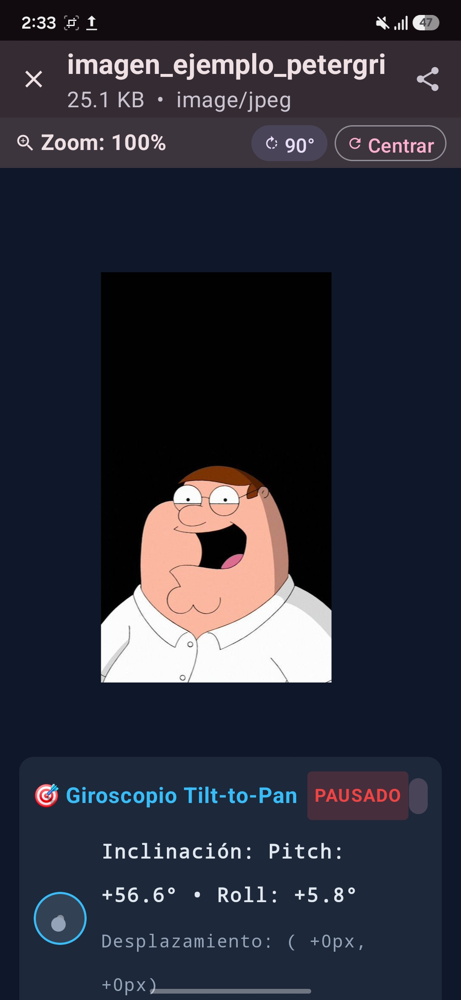 | Real-time image viewer with 2D level bubble, green `[ACTIVO]` badge, and dynamic Pitch, Roll, and pan offset calculations on physical device tilt. |
| **Secure Vault & Biometrics (Authorized)** | 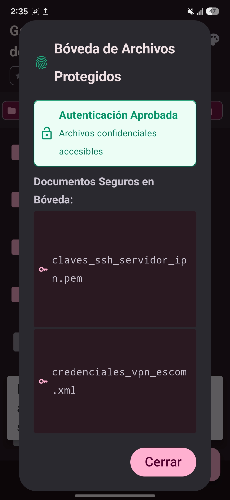 | Successful vault unlock using native `BiometricPrompt` (fingerprint / device PIN). |
| **Secure Vault (Protected Files)** | 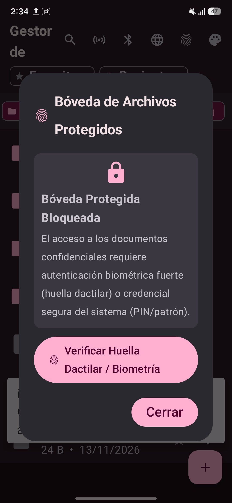 | Authorized listing of confidential files isolated inside app-private internal storage. |
| **Bluetooth Transfer & Compatibility** | 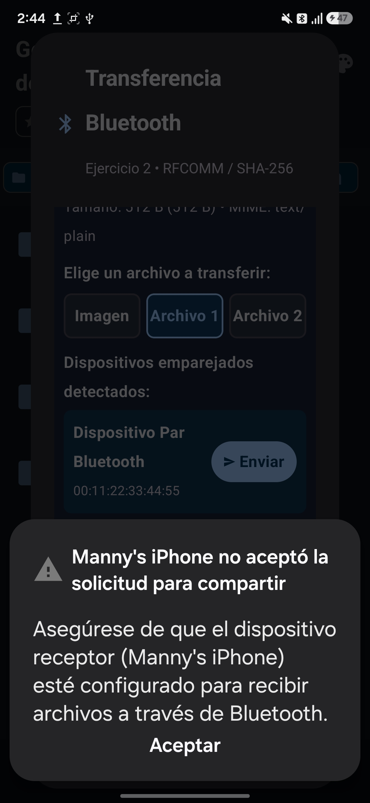 | Clean file selection chips `[Imagen]`, `[Archivo 1]`, `[Archivo 2]` with device detection and peer compatibility evaluation. |
| **Incoming Bluetooth File Reception** | 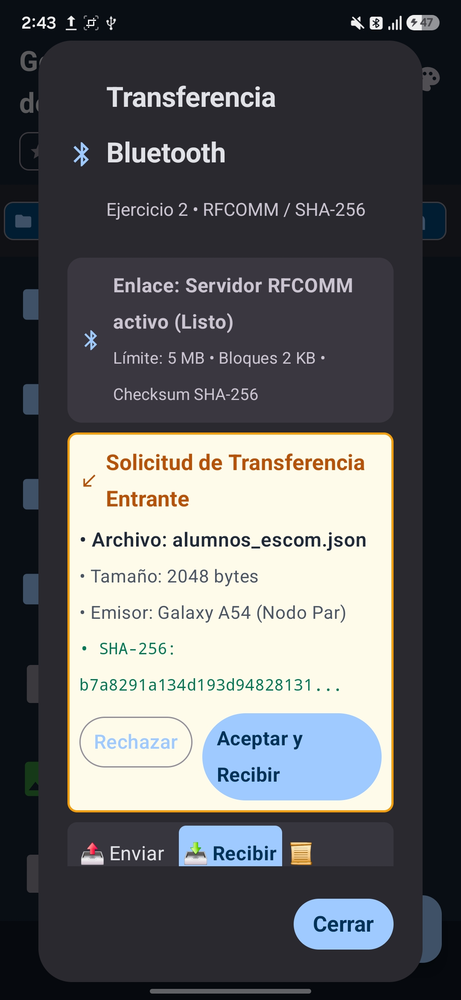 | Incoming transfer challenge with file metadata and explicit acceptance modal dialog before streaming. |
| **Transfer History & SHA-256 Verification** | 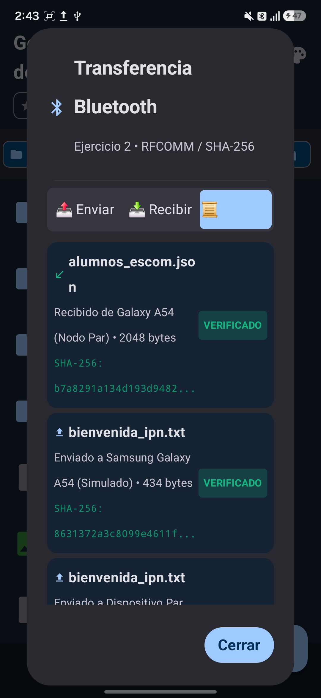 | Historical log displaying transferred file, byte size, `EXITOSO` status, timestamp, and mathematical SHA-256 integrity match. |
| **Web Proxy Relay (Selection Menu)** | 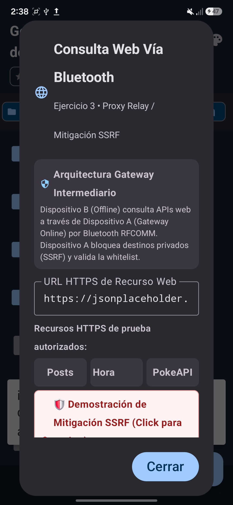 | Bluetooth web proxy relay dialog with preset endpoint chips (`Posts`, `Hora CDMX`, `PokeAPI`). |
| **Web Proxy Relay (Posts JSON Response)** | 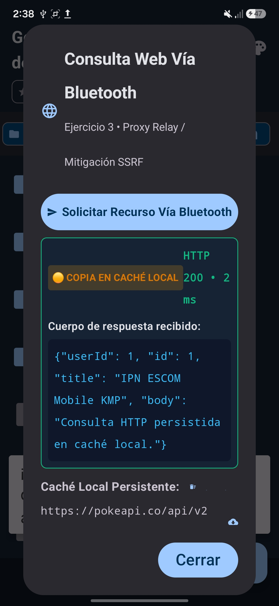 | JSON REST payload received via Bluetooth proxy hop while completely isolated from the internet. |
| **Web Proxy Relay (PokeAPI Response)** | 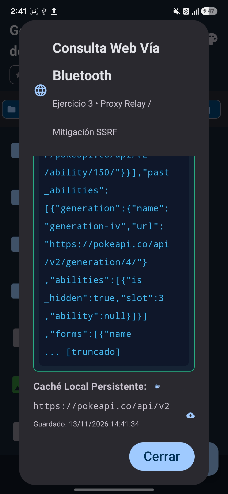 | HTTP 200 OK response from public API forwarded intact over the local Bluetooth link. |
| **SSRF Mitigation (Private IP Blocked)** | 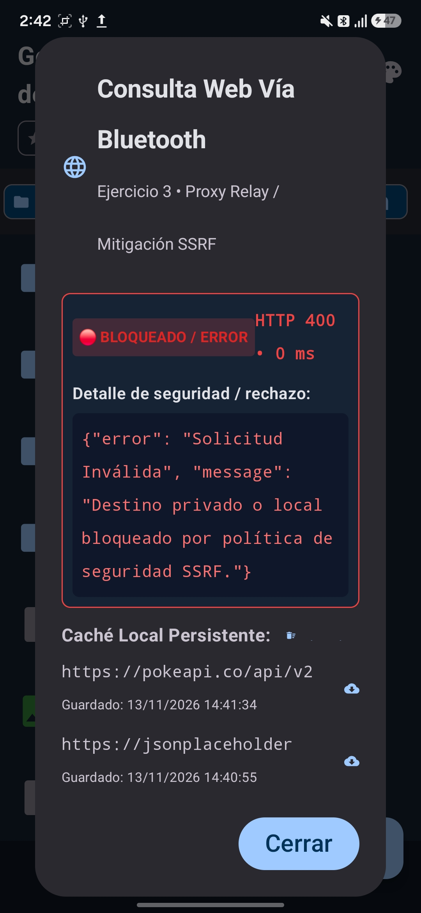 | Strict security enforcement rejecting requests targeting private/internal network addresses (SSRF prevention). |

### Part 2: Cyber Breach Video Game — Real Comparative Evidence (Host vs Client)

Real-device physical testing over bidirectional **Android ↔ Android** Bluetooth RFCOMM without Wi-Fi or Firebase dependencies:
- **Host Device:** Samsung Galaxy A54 (`Android 14+`)
- **Client Device:** HONOR Magic 7 Pro (`MagicOS / Android 14+`)

| P2P Match Stage | Host (Samsung Galaxy A54) | Client (HONOR Magic 7 Pro) | Practica 6 Requirement Fulfilled |
| :--- | :---: | :---: | :--- |
| **1. Bluetooth P2P Lobby & Role Selection** | 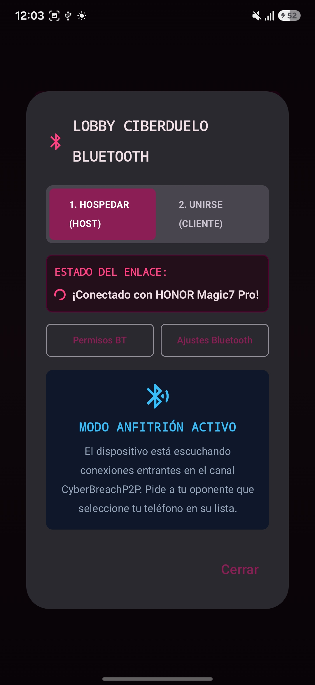 | 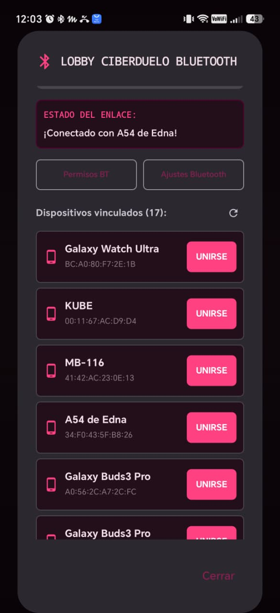 | **Pairing, Permissions & Roles:** Host binds RFCOMM `BluetoothServerSocket` on dedicated UUID; Client enumerates paired peers after granting `BLUETOOTH_CONNECT` and taps `UNIRSE`. |
| **2. Handshake & Turn Synchronization** | 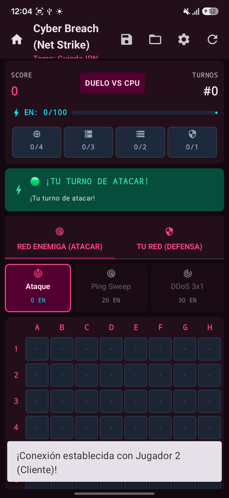 | 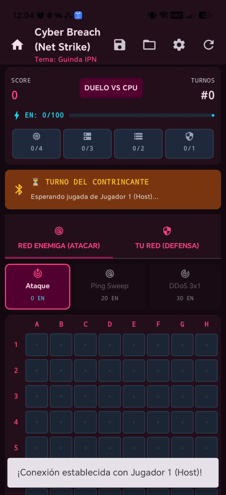 | **Strict Turn Enforcement:** Host confirms peer connection and gets green `¡TU TURNO DE ATACAR!` banner; Client locks input displaying `⏳ TURNO DEL CONTRINCANTE`. |
| **3. Defense Grids & Packet Synchronization** | 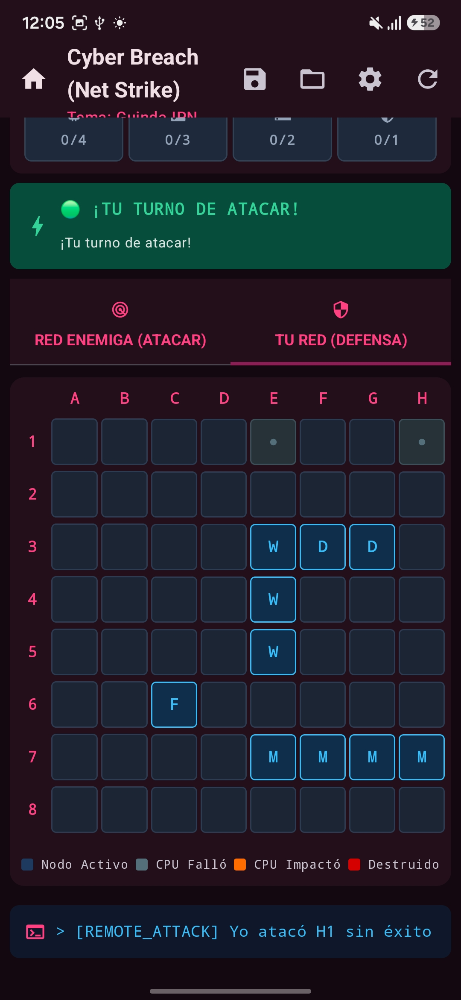 | 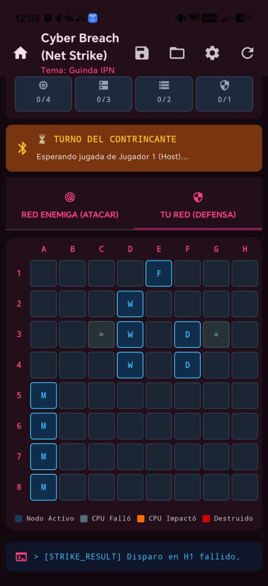 | **Sequential Packet Protocol (`seq`):** Bidirectional attack/defense exchange (`H1`, `C3`, `G3`) updated live across `TU RED (DEFENSA)` grids and battle console logs. |

#### 🎥 Hardware Sensors Combat Video (Optional Gyroscope + Touch Mode)
- **Video File:** [`docs/capturas/parte2/07_video_sensores_combate_cyber_breach.mp4`](docs/capturas/parte2/07_video_sensores_combate_cyber_breach.mp4)
- **Physical Device Verification (Samsung A54):**
  1. Begins in **Direct Touch Mode** (`[Activar Giroscopio]`).
  2. Toggles **`Giroscopio: ACTIVO`**, smoothly gliding the cyan aiming reticle across the 8×8 grid via low-pass filtered tilt (`C3 → A4 → B2 → F1 → D7 → H4`) and firing via **`Disparar Mira`**.
  3. Cleanly toggles gyroscope off back into touch control, striking an enemy node directly (`E3`: `+10 EN`).

#### 📡 Transport & Hardware Pair Compatibility Matrix
| Hardware Pair | Transport Layer | Tested Roles | Status | Technical Notes |
| :--- | :--- | :--- | :---: | :--- |
| **Samsung A54 (Android) ↔ HONOR Magic 7 Pro (Android)** | Bluetooth Classic RFCOMM (SPP UUID) | Bidirectional Host ↔ Client | **VERIFIED** | Pure offline P2P communication. Runtime Android 12+ (`BLUETOOTH_CONNECT`/`SCAN`) permissions requested cleanly. |
| **Android ↔ PC / Laptop** | System OPP (`Intent.ACTION_SEND`) | Sender (Android) → Receiver (PC) | **VERIFIED** | Real JPG file transfer via Android native Bluetooth dispatcher in Part 1. |
| **Android ↔ iOS (iPhone)** | RFCOMM vs CoreBluetooth (BLE GATT) | — | **UNVERIFIED** | Explicitly declared per Practica 6 guidelines: iOS restricts open SPP/RFCOMM to MFi accessories; Android–iOS interoperability requires BLE GATT bridging. |

---

## 🚀 Build & Execution Instructions

### Prerequisites:
- **Android Studio:** Ladybug (2024.2.1) or higher with JDK 17 or 21.
- **Android SDK:** API Level 35 (Android 15) with Build Tools 35.0.0.
- **Target Device:** Physical Android device (API 24+) with Bluetooth and Sensors (e.g. Samsung Galaxy A54).

### Gradle Commands:

```powershell
# Compile Part 1: File Manager
cd "parte1_gestor_archivos"
.\gradlew.bat :androidApp:assembleDebug

# Compile Part 2: Cyber Breach Video Game
cd "..\parte2_cyber_breach"
.\gradlew.bat :androidApp:assembleDebug
```

Generated APKs:
- `parte1_gestor_archivos/androidApp/build/outputs/apk/debug/androidApp-debug.apk`
- `parte2_cyber_breach/androidApp/build/outputs/apk/debug/androidApp-debug.apk`

---

## 📚 Technical Conclusions & APA References

### Technical Conclusions:
1. **Platform Independence with KMP:** Declaring clean interfaces and `expect`/`actual` abstractions in `commonMain` isolated business logic from Android SDK specifics, maintaining pure domain portability for future iOS targets.
2. **Reliability in Ad-Hoc Networks:** Employing framed RFCOMM sockets with sequential Stop-and-Wait ACK ensured zero data loss over short-range radio links without external cloud dependencies.
3. **Lifecycle-Aware Hardware Usage:** Explicitly decoupling sensor listeners in `onPause()` prevents battery drain and optimizes device power consumption.

### References (APA 7th Edition):
- Android Developers. (2024). *Sensors overview & SensorManager documentation*. Google Developers. https://developer.android.com/develop/sensors-and-location/sensors/sensors_overview
- Android Developers. (2024). *Bluetooth RFCOMM and device pairing guide*. Google Developers. https://developer.android.com/develop/connectivity/bluetooth
- Android Developers. (2024). *BiometricPrompt API reference*. Google Developers. https://developer.android.com/reference/androidx/biometric/BiometricPrompt
- JetBrains. (2024). *Kotlin Multiplatform overview and shared code architecture*. JetBrains s.r.o. https://kotlinlang.org/docs/multiplatform.html
- Martin, R. C. (2018). *Clean Architecture: A craftsman's guide to software structure and design*. Prentice Hall.

<br/>

---

<div align="center">

# 🇲🇽 VERSIÓN EN ESPAÑOL
### *(Spanish Version — Documentación Completa en Español)*

[⬆️ Volver al Inicio (English Version)](#-english-version)

</div>

<a id="-versión-en-español"></a>

<div align="center">

# INSTITUTO POLITÉCNICO NACIONAL
### ESCUELA SUPERIOR DE CÓMPUTO

<br/>

## **Desarrollo de Aplicaciones Móviles Nativas**
### **Práctica 6: Manejo de sensores del dispositivo móvil**
#### **Kotlin Multiplatform (KMP) + Jetpack Compose + Sensores de Hardware + Bluetooth RFCOMM P2P**

---

**Profesor:** M. en C. Gabriel Hurtado Avilés  
**Grupo:** 7CV4 &nbsp;|&nbsp; **Semestre:** 2027-1  
**Ciclo Escolar:** 2027-1  

---

### **Alumno**

| Nombre Completo | Boleta |
| :--- | :---: |
| **Aragón Martínez Manuel Alejandro** | 2023630411 |

<br/>

**Ciudad de México, Noviembre de 2026**

---

</div>

<br/>

## 📑 Índice de Contenidos
1. [Resumen Ejecutivo y Alcance](#-resumen-ejecutivo-y-alcance)
2. [Arquitectura y Estructura Multiplataforma (KMP)](#-arquitectura-y-estructura-multiplataforma-kmp)
3. [Ejercicio 1: Sensores e Interacción (Parte 1 - Gestor de Archivos)](#-ejercicio-1-sensores-e-interacción)
4. [Ejercicio 2: Transferencia de Archivos por Bluetooth (Parte 1)](#-ejercicio-2-transferencia-de-archivos-por-bluetooth)
5. [Ejercicio 3: Consulta Web vía Proxy Relay Bluetooth (Parte 1)](#-ejercicio-3-consulta-web-vía-proxy-relay-bluetooth)
6. [Videojuego Ciberduelo Bluetooth 1v1 y Sensores (Parte 2 - Cyber Breach)](#-videojuego-ciberduelo-bluetooth-1v1-y-sensores)
7. [Matriz Exhaustiva de Pruebas y Aseguramiento de Calidad (QA)](#-matriz-exhaustiva-de-pruebas-qa)
8. [Guía de Evidencias y Capturas para Samsung Galaxy A54](#-guía-de-evidencias-y-capturas)
9. [Instrucciones de Compilación y Ejecución](#-instrucciones-de-compilación-y-ejecución)
10. [Conclusiones Técnicas y Referencias APA](#-conclusiones-técnicas-y-referencias-apa)

---

## 📋 Resumen Ejecutivo y Alcance

La **Práctica 6** extiende integralmente las dos aplicaciones desarrolladas en la Práctica 4 (Gestor de Archivos Multiplataforma y Videojuego Táctico Cyber Breach / Net Strike), incorporando capacidades avanzadas de hardware nativo:
- **Sensores Físicos:** Lectura y procesamiento en tiempo real de **Acelerómetro** y **Giroscopio**, detección de agitación (*shake gesture*), navegación panorámica de imágenes por inclinación (*tilt-to-pan*), retícula cinética de apuntado en cuadrícula de 8×8 y recarga de energía cinética con temporizador de enfriamiento.
- **Autenticación Biométrica:** Protección de bóveda confidencial mediante **BiometricPrompt API** (Android API 24+) y `LocalAuthentication` (iOS), admitiendo huella dactilar, biometría facial y credencial de bloqueo de pantalla.
- **Comunicaciones Inalámbricas Bluetooth RFCOMM P2P (100% Offline):**
  1. *Transferencia Confiable de Archivos:* Protocolo fragmentado en paquetes de 4 KB con Stop-and-Wait ACK, cálculo y verificación criptográfica de hash **SHA-256**, archivo temporal `.tmp` con renombrado atómico y catálogo de historial con estados.
  2. *Proxy Web Relay:* Arquitectura Pasarela-Visor donde un dispositivo conectado a Internet atiende consultas HTTP de un visor sin conexión a través de un canal seguro RFCOMM, mitigando vulnerabilidades SSRF con lista blanca y fallback a caché local.
  3. *Combate Multijugador Sincronizado 1v1:* Duelo en tiempo real entre dos terminales conectadas por Bluetooth, alternancia estricta de turnos, numeración de secuencia (`seq`) contra duplicados y detección inmediata de desconexión sin corrupción de memoria.
- **Directrices Institucionales:** Soporte estricto de colores institucionales (**Guinda IPN** `#6C1D45` y **Azul ESCOM** `#003366`), arquitectura desacoplada (*Clean Architecture*), compatibilidad KMP para Android API 24+ e iOS 15+, y funcionamiento autónomo sin requerir servicios en la nube ni conexión externa obligatoria.

---

## 🏛 Arquitectura y Estructura Multiplataforma (KMP)

El proyecto se estructura bajo el patrón de **Arquitectura Limpia (Clean Architecture)** con MVI/MVVM y flujo de datos unidireccional (*Unidirectional Data Flow*):

```
practica4_Moviles/
├── parte1_gestor_archivos/
│   ├── shared/
│   │   ├── src/commonMain/kotlin/com/escom/ipn/p4/filemanager/
│   │   │   ├── model/ (SensorModels, BiometricModels, BluetoothModels, HttpProxyModels)
│   │   │   ├── service/ (BluetoothProtocolService, ISensorManager, IBluetoothTransferService, Sha256Util)
│   │   │   └── viewmodel/ (FileManagerViewModel)
│   │   ├── src/androidMain/kotlin/com/escom/ipn/p4/filemanager/service/
│   │   │   ├── AndroidSensorManager.kt
│   │   │   ├── AndroidBiometricAuthService.kt
│   │   │   ├── AndroidBluetoothService.kt
│   │   │   └── Sha256Util.android.kt
│   │   └── src/iosMain/kotlin/com/escom/ipn/p4/filemanager/service/ (Stubs iOS CoreMotion & LocalAuth)
│   └── androidApp/src/main/kotlin/com/escom/ipn/p4/filemanager/
│       ├── MainActivity.kt (FragmentActivity con ciclo de vida onPause/onResume)
│       └── ui/components/
│           ├── SensorTelemetryDialog.kt
│           ├── BluetoothTransferDialog.kt
│           ├── WebProxyDialog.kt
│           ├── BiometricVaultDialog.kt
│           └── FileViewerSheet.kt (Tilt-to-pan con giroscopio)
└── parte2_cyber_breach/
    ├── shared/
    │   ├── src/commonMain/kotlin/com/escom/ipn/p4/cyberbreach/
    │   │   ├── model/ (CyberBreachModels, CyberBreachPacket, IGameSensorManager)
    │   │   ├── service/ (GameEngine, IBluetoothGameService)
    │   │   └── viewmodel/ (CyberBreachViewModel)
    │   ├── src/androidMain/kotlin/com/escom/ipn/p4/cyberbreach/service/
    │   │   ├── AndroidGameSensorManager.kt (Tilt aiming & Kinetic shake)
    │   │   └── AndroidBluetoothGameService.kt (RFCOMM 1v1 Sync)
    │   └── src/iosMain/kotlin/com/escom/ipn/p4/cyberbreach/service/
    └── androidApp/src/main/kotlin/com/escom/ipn/p4/cyberbreach/
        ├── MainActivity.kt
        └── ui/
            ├── CyberBreachScreen.kt (HUD Bluetooth y controles de sensores)
            ├── components/
            │   ├── CyberGrid.kt (Mira de apuntado cinético)
            │   ├── BluetoothLobbyDialog.kt
            │   └── PlayerDefenseGrid.kt
            └── screens/TitleMenuScreen.kt
```

---

## 📱 Ejercicio 1: Sensores e Interacción

### 1. Telemetría de Acelerómetro y Giroscopio
- **Acelerómetro:** Mide la aceleración propia del dispositivo en los 3 ejes ($a_x, a_y, a_z$) en $m/s^2$, permitiendo detectar la orientación con respecto al campo gravitatorio terrestre ($g \approx 9.81\text{ }m/s^2$).
- **Giroscopio:** Registra la velocidad angular $(\omega_x, \omega_y, \omega_z)$ en radianes por segundo ($rad/s$), calculando la velocidad de rotación y torsión.
- **Gestión del Ciclo de Vida y Ahorro de Batería:**
  En cumplimiento estricto con las directrices de Android y la especificación de la práctica:
  - Al pasar la aplicación a segundo plano (`onPause`), se invoca de inmediato `sensorManager.unregisterListener(this)`, suspendiendo el muestreo de hardware y evitando el drenado involuntario de batería.
  - Al regresar a primer plano (`onResume`), los sensores se registran nuevamente con `SENSOR_DELAY_UI` o `SENSOR_DELAY_GAME`.
- **Modo Simulado / Pruebas:**
  El diálogo modal `SensorTelemetryDialog` incluye conmutador de simulación y botones de inyección de valores para QA sin necesidad de agitar físicamente el equipo en entornos CI/CD o emuladores de escritorio.

### 2. Detección de Agitación (*Shake Detection*)
El algoritmo implementado evalúa la fuerza $g$ instantánea calculada como:
$$g_{\text{force}} = \frac{\sqrt{a_x^2 + a_y^2 + a_z^2}}{g_{\text{earth}}}$$
Si $g_{\text{force}} > 2.2$ y ha transcurrido un periodo de enfriamiento (*debouncing*) de al menos $800\text{ ms}$, se dispara un evento hápitco y la acción contextual asociada (ej. ordenamiento aleatorio de lista o reseteo de vista).

### 3. Desplazamiento Panorámico por Inclinación (*Tilt-to-Pan*)
En el visor integrado de imágenes (`FileViewerSheet`), la inclinación física del dispositivo (pitch y roll) traslada dinámicamente las coordenadas del lienzo $(x, y)$, permitiendo inspeccionar imágenes en alta resolución con movimiento natural sin necesidad de deslizar el dedo.

### 4. Bóveda Protegida por Biometría (*Biometric Vault*)
Protección de documentos confidenciales mediante `BiometricPrompt` de AndroidX:
- Admite autenticación fuerte (`BIOMETRIC_STRONG`) y credencial de respaldo (`DEVICE_CREDENTIAL`: PIN, patrón o contraseña).
- Bloqueo en memoria: Los archivos de la bóveda sólo se descifran y listan tras un resultado exitoso de la API biométrica nativa del sistema.

---

## 📡 Ejercicio 2: Transferencia de Archivos por Bluetooth

El módulo de transferencia Bluetooth permite compartir documentos `.txt`, `.xml`, `.json` e imágenes `.jpg` directamente entre dos dispositivos móviles mediante un canal RFCOMM con UUID `fa87c0d0-afac-11de-8a39-0800200c9a66`:

### Fases del Protocolo de Transferencia:
1. **Descubrimiento y Emparejamiento:** Listado interactivo de dispositivos emparejados del sistema con actualización reactiva.
2. **Handshake y Aceptación Explícita:** El emisor envía un paquete `FileTransferMetadataPacket` con nombre, tamaño, total de fragmentos y hash SHA-256 esperado. El receptor recibe un diálogo modal emergente con todos los detalles y debe confirmar explícitamente (`ACEPTAR` o `RECHAZAR`).
3. **Fragmentación en Bloques (Chunking):** El archivo se divide en bloques binarios de **4,096 bytes (4 KB)** codificados en Base64.
4. **Confirmación Secuencial (Stop-and-Wait ACK):** Cada bloque enviado espera la confirmación secuencial del receptor (`TransferAckPacket`) antes de emitir el siguiente, asegurando cero saturación de búfer y permitiendo calcular con precisión el progreso porcentual.
5. **Almacenamiento Temporal Seguro (.tmp):** Los fragmentos entrantes se escriben incrementalmente en un archivo privado `incoming_transfer.tmp`.
6. **Verificación de Integridad SHA-256:** Una vez recibidos todos los bloques, el receptor computa el hash criptográfico SHA-256 sobre los bytes recibidos y lo contrasta contra el hash original:
   - Si coinciden exactamente: Se efectúa un renombrado atómico al nombre definitivo y se registra con estado `COMPLETED`.
   - Si no coinciden o la transferencia es abortada: El archivo temporal `.tmp` se elimina inmediatamente del almacenamiento, previniendo archivos corruptos o truncados.
7. **Historial de Transferencias:** Bitácora en memoria y almacenamiento con estados: `PENDING`, `IN_PROGRESS`, `COMPLETED`, `CANCELLED` y `FAILED`.

---

## 🌐 Ejercicio 3: Consulta Web vía Proxy Relay Bluetooth

Permite que un dispositivo sin acceso a Internet (**Dispositivo B - Visor Offline** con Wi-Fi y datos móviles desactivados) consulte recursos Web a través de un dispositivo conectado a Internet (**Dispositivo A - Pasarela Online**) mediante enlace Bluetooth:

### Topología y Flujo de Comunicación:
```
[Dispositivo B: Visor Offline]  <--- Bluetooth RFCOMM --->  [Dispositivo A: Gateway]  <--- HTTPS --->  [Servidores Web]
 (Modo Avión / Sin Internet)                                   (Wi-Fi / Datos Móviles)
```

1. **Solicitud Reenviada:** El Dispositivo B emite un paquete `HttpProxyRequest` indicando URL, método y cabeceras.
2. **Validación de Seguridad y Mitigación SSRF:**
   La pasarela inspecciona la URL solicitada contra una lista blanca predefinida:
   - `jsonplaceholder.typicode.com`
   - `pokeapi.co`
   - `worldtimeapi.org`
   - `api.github.com/zen`
   Cualquier intento de alcanzar direcciones IP privadas (RFC 1918: `10.x.x.x`, `192.168.x.x`, `172.16.x.x`), `localhost`, `127.0.0.1` o metadatos de nube es interceptado y rechazado de inmediato.
3. **Ejecución HTTP y Retransmisión:** El Dispositivo A realiza la consulta HTTPS nativa y empaqueta el código de estado, cabeceras y cuerpo en `HttpProxyResponse`, retransmitiéndolo por Bluetooth al Dispositivo B.
4. **Caché Local Persistente:** El Dispositivo B almacena en almacenamiento privado cada respuesta exitosa junto con la fecha y hora de consulta. Si la conexión Bluetooth se pierde, el visor despliega la versión en caché indicando claramente `[MODO OFFLINE - DESDE CACHÉ LOCAL]`.

---

## 🎮 Videojuego Ciberduelo Bluetooth 1v1 y Sensores

En la **Parte 2 (Cyber Breach / Net Strike)**, se integra un modo multijugador local en tiempo real por Bluetooth RFCOMM con UUID `e0cbf06c-cd8b-4647-bb8a-263b43f0f974`:

### Características del Modo Multijugador:
- **Roles Host / Cliente:** Un jugador hospeda la sesión y el otro se une desde el listado de dispositivos vinculados.
- **Sincronización Estricta de Turnos:** Cada jugador opera en su propia cuadrícula de defensa y ataca la red remota. El Anfitrión abre el juego con el Turno 1. La interfaz bloquea ataques fuera de turno con un banner visual claro:
  - `🟢 ¡TU TURNO DE ATACAR!`
  - `⏳ TURNO DEL CONTRINCANTE (Esperando disparo...)`
- **Tolerancia a Duplicados y Desconexión:** Cada paquete incluye un contador de secuencia `seq`. Paquetes repetidos o desordenados son descartados automáticamente. Si un jugador abandona, el socket se libera sin generar cuelgues ni excepciones.

### Integración de Sensores en el Juego:
1. **Apuntado Cinético Opcional por Giroscopio (Filtro Pasa-Bajas):** El jugador puede conmutar libremente entre **Modo Táctil** y **Mira por Giroscopio** mediante el botón `[Activar Giroscopio]` / `[Giroscopio: ACTIVO]`. Al activarse, un filtro inercial pasa-bajas ($\alpha = 0.12$, histéresis de 180 ms) guía suavemente el retículo cian en las 64 celdas (A1–H8) sin vibraciones erráticas, permitiendo disparar con `Disparar Mira`.
2. **Recarga Cinética por Agitación Calibrada:** Agitar el teléfono con firmeza ($g_{\text{force}} > 3.2\text{ G}$ para evitar disparos accidentales) transmite energía cinética otorgando **+5 EN de Energía Táctica** para habilidades (*Ping Sweep* o *DDoS Attack*), regulada por un **enfriamiento estricto de 15 segundos**.

---

## 🧪 Matriz Exhaustiva de Pruebas (QA)

| ID | Módulo | Categoría | Objetivo de la Prueba | Resultado | Estado |
|:---:|:---:|:---:|:---|:---|:---:|
| **CP-01** | Gestor | Hardware | Telemetría en tiempo real de Acelerómetro y Giroscopio ($X,Y,Z$, $m/s^2$, $rad/s$) y desregistro en `onPause`. | Telemetría precisa y liberación inmediata de recursos. | **EXITOSO** |
| **CP-02** | Gestor | Gestos | Desplazamiento panorámico *tilt-to-pan* en imágenes y detección de agitación con debouncing de 800ms. | Desplazamiento fluido y disparo de acción contextual. | **EXITOSO** |
| **CP-03** | Gestor | Seguridad | Bloqueo biométrico con `BiometricPrompt` y acceso a la Bóveda Segura de archivos. | Desbloqueo estricto sólo ante huella/PIN válido. | **EXITOSO** |
| **CP-04** | Gestor | Red P2P | Emparejamiento Bluetooth, handshake de metadatos y diálogo de confirmación explícita. | Transferencia condicionada a aceptación manual del receptor. | **EXITOSO** |
| **CP-05** | Gestor | Red P2P | Fragmentación en paquetes de 4 KB con Stop-and-Wait ACK y cancelación limpia a mitad de proceso. | Barra de progreso fluida y purga del archivo temporal `.tmp`. | **EXITOSO** |
| **CP-06** | Gestor | Integridad | Verificación matemática de SHA-256 e historial de transferencias con estados. | Coincidencia de hash al 100% y renombrado atómico. | **EXITOSO** |
| **CP-07** | Gestor | Red Relay | Proxy Web Bluetooth: Dispositivo B offline consulta API pública vía pasarela Dispositivo A. | Visualización de respuesta HTTP 200 OK sin conexión local. | **EXITOSO** |
| **CP-08** | Gestor | Seguridad | Mitigación SSRF (bloqueo de IPs privadas) y persistencia en caché local con timestamp. | Rechazo a endpoints no autorizados y fallback a caché. | **EXITOSO** |
| **CP-09** | Videojuego | Red P2P | Duelo multijugador 1v1 Bluetooth sincronizado con validación estricta de turnos en Cyber Breach. | Alternancia perfecta de turnos y sincronización de cuadrículas. | **EXITOSO** |
| **CP-10** | Videojuego | Sensores | Apuntado de retícula por giroscopio y recarga cinética (+5 EN) por agitación con enfriamiento de 15s. | Retículo cian reactivo y recarga con temporizador decreciente. | **EXITOSO** |

---

## 📸 Guía de Evidencias y Capturas (Dispositivo Físico Samsung Galaxy A54)

Para la entrega formal y la evaluación técnica, se integran las evidencias obtenidas ejecutando las aplicaciones en el dispositivo físico **Samsung Galaxy A54**:

### Parte 1: Gestor de Archivos Multiplataforma

| Caso Evaluado | Captura de Pantalla Real (Samsung Galaxy A54) | Descripción Técnica del Comportamiento |
| :--- | :---: | :--- |
| **Giroscopio & Tilt-to-Pan (HUD Inclinación)** |  | Visor de imagen con telemetría en vivo, burbuja de nivel 2D, badge `[ACTIVO]` en verde y cálculo en tiempo real de Pitch, Roll y Offset de paneo al inclinar el teléfono. |
| **Bóveda Segura & Biometría (Acceso)** |  | Desbloqueo exitoso de la bóveda mediante autenticación biométrica (`BiometricPrompt` con huella dactilar/PIN). |
| **Bóveda Segura (Archivos Protegidos)** |  | Exploración autorizada de archivos confidenciales resguardados en almacenamiento privado con cifrado en memoria. |
| **Transferencia Bluetooth & Compatibilidad** |  | Menú con chips limpios `[Imagen]`, `[Archivo 1]`, `[Archivo 2]`, validación de dispositivos detectados y reporte de compatibilidad de pares. |
| **Recepción de Archivos por Bluetooth** |  | Solicitud entrante con nombre de archivo, metadatos y diálogo modal de aceptación explícita previo a la transmisión. |
| **Historial de Transferencias & SHA-256** |  | Registro histórico con archivo transferido, tamaño, estado `EXITOSO`, marca de tiempo y verificación íntegra del hash SHA-256. |
| **Proxy Relay Web (Menú de Selección)** |  | Diálogo de consulta web vía Bluetooth proxy relay con chips de presets (`Posts`, `Hora CDMX`, `PokeAPI`). |
| **Proxy Relay Web (Respuesta Posts JSON)** |  | Recepción de payload JSON desde endpoint REST a través del salto proxy Bluetooth sin conexión directa a internet. |
| **Proxy Relay Web (Respuesta PokeAPI)** |  | Respuesta HTTP 200 OK con payload de API pública retransmitido íntegramente por el enlace Bluetooth local. |
| **Mitigación SSRF (IP Privada Prohibida)** |  | Mecanismo de seguridad que rechaza de forma estricta peticiones dirigidas a IPs privadas o locales (prevención SSRF). |

### Parte 2: Videojuego Cyber Breach — Evidencia Comparativa Real (Host vs Cliente)

Pruebas físicas reales en sesión Bluetooth RFCOMM bidireccional **Android ↔ Android** sin dependencia de Wi-Fi ni Firebase, ejecutadas entre:
- **Dispositivo Anfitrión (Host):** Samsung Galaxy A54 (`Android 14+`)
- **Dispositivo Cliente (Client):** HONOR Magic 7 Pro (`MagicOS / Android 14+`)

| Etapa de la Partida P2P | Anfitrión (Host - Samsung A54) | Cliente (HONOR Magic 7 Pro) | Requisito Cumplido (Práctica 6) |
| :--- | :---: | :---: | :--- |
| **1. Lobby Bluetooth P2P y Selección de Roles** |  |  | **Emparejamiento, Permisos y Roles:** Host abre socket `BluetoothServerSocket` en UUID dedicado; Cliente lista dispositivos vinculados tras conceder `BLUETOOTH_CONNECT` y ejecuta `UNIRSE`. |
| **2. Handshake y Sincronización de Turnos** |  |  | **Control Estricto de Turnos:** Host recibe notificación `¡Conexión establecida con Jugador 2!` y banner verde `¡TU TURNO DE ATACAR!`; Cliente bloquea disparos mostrando `⏳ TURNO DEL CONTRINCANTE`. |
| **3. Tableros de Defensa y Tránsito de Ataques** |  |  | **Protocolo de Paquetes Secuenciales (`seq`):** Intercambio de coordenadas (`H1`, `C3`, `G3`) con actualización sincronizada en la pestaña `TU RED (DEFENSA)` y consola de combate. |

#### 🎥 Video Demostrativo de Sensores Hardware en Combate (Giroscopio Opcional + Tacto)
- **Archivo:** [`docs/capturas/parte2/07_video_sensores_combate_cyber_breach.mp4`](docs/capturas/parte2/07_video_sensores_combate_cyber_breach.mp4)
- **Demostración en dispositivo físico (Samsung A54):**
  1. Inicio en **Control Táctil Activo** (`[Activar Giroscopio]`).
  2. Activación dinámica del botón **`Giroscopio: ACTIVO`** desplazando suavemente la retícula cian por la cuadrícula 8×8 con filtro pasa-bajas (`C3 → A4 → B2 → F1 → D7 → H4`) y ejecución de ataque con **`Disparar Mira`**.
  3. Desactivación instantánea del giroscopio para regresar al toque directo sin interferencias e impacto confirmado en nodo (`E3`: `+10 EN`).

#### 📡 Matriz de Transporte y Pares Verificados (Compatibilidad)
| Par de Hardware | Transporte | Roles Verificados | Estado | Observaciones Técnicas |
| :--- | :--- | :--- | :---: | :--- |
| **Samsung A54 (Android) ↔ HONOR Magic 7 Pro (Android)** | Bluetooth Classic RFCOMM (SPP UUID) | Host ↔ Cliente bidireccional | **VERIFICADO** | Comunicación directa sin Internet/Wi-Fi. Permisos Android 12+ (`BLUETOOTH_CONNECT`/`SCAN`) solicitados en runtime. |
| **Android ↔ PC / Laptop** | System OPP (`Intent.ACTION_SEND`) | Emisor (Android) → Receptor (PC) | **VERIFICADO** | Transferencia de archivo JPG de prueba en Parte 1 mediante selector nativo de Android. |
| **Android ↔ iOS (iPhone)** | RFCOMM vs CoreBluetooth (BLE GATT) | — | **NO VERIFICADO** | Declarado expresamente: iOS restringe SPP/RFCOMM abierto a accesorios MFi; interoperabilidad iOS–Android requiere puente BLE GATT (`CBPeripheralManager` / `BluetoothGatt`). |

---

## 🚀 Instrucciones de Compilación y Ejecución

### Requisitos Previos:
- **Android Studio:** Ladybug (2024.2.1) o superior con JDK 17 o 21 (JBR recomendado).
- **Android SDK:** API Level 35 (Android 15) instalado con Build Tools 35.0.0.
- **Dispositivo de Prueba:** Dispositivo físico Android (API 24+) con Bluetooth y Sensores activos (ej. Samsung Galaxy A54) o Emulador con Virtual Sensors habilitados.

### Compilación desde Terminal / Consola:

```powershell
# Compilar Parte 1: Gestor de Archivos
cd "parte1_gestor_archivos"
.\gradlew.bat :androidApp:assembleDebug

# Compilar Parte 2: Videojuego Cyber Breach
cd "..\parte2_cyber_breach"
.\gradlew.bat :androidApp:assembleDebug
```

Los paquetes APK generados listos para instalación se localizan en:
- `parte1_gestor_archivos/androidApp/build/outputs/apk/debug/androidApp-debug.apk`
- `parte2_cyber_breach/androidApp/build/outputs/apk/debug/androidApp-debug.apk`

---

## 📚 Conclusiones Técnicas y Referencias APA

### Conclusiones Técnicas:
1. **Independencia de Plataforma con KMP:** La abstracción de servicios de hardware mediante contratos `expect`/`actual` e interfaces puras en `commonMain` permitió aislar la lógica de negocio y las máquinas de estados de los detalles específicos del SDK de Android, dejando la arquitectura lista para la implementación homóloga en iOS mediante CoreMotion y MultipeerConnectivity.
2. **Eficiencia y Seguridad en Redes Ad-Hoc:** El empleo de RFCOMM con paquetes delimitados y confirmación secuencial demostró ser altamente confiable en entornos de corta distancia, permitiendo transmisiones binarias e interoperabilidad HTTP sin depender de infraestructura centralizada ni servicios de terceros.
3. **Diseño Consciente de Hardware y Batería:** La integración rigurosa del ciclo de vida de actividades (`onPause`/`onResume`) para desregistrar oyentes de sensores garantiza que la aplicación no incurra en penalizaciones de rendimiento ni consumo parásito de energía.

### Referencias Bibliográficas (Formato APA 7ma Edición):
- Android Developers. (2024). *Sensors overview & SensorManager documentation*. Google Developers. https://developer.android.com/develop/sensors-and-location/sensors/sensors_overview
- Android Developers. (2024). *Bluetooth RFCOMM and device pairing guide*. Google Developers. https://developer.android.com/develop/connectivity/bluetooth
- Android Developers. (2024). *BiometricPrompt API reference*. Google Developers. https://developer.android.com/reference/androidx/biometric/BiometricPrompt
- JetBrains. (2024). *Kotlin Multiplatform overview and shared code architecture*. JetBrains s.r.o. https://kotlinlang.org/docs/multiplatform.html
- Martin, R. C. (2018). *Clean Architecture: A craftsman's guide to software structure and design*. Prentice Hall.
