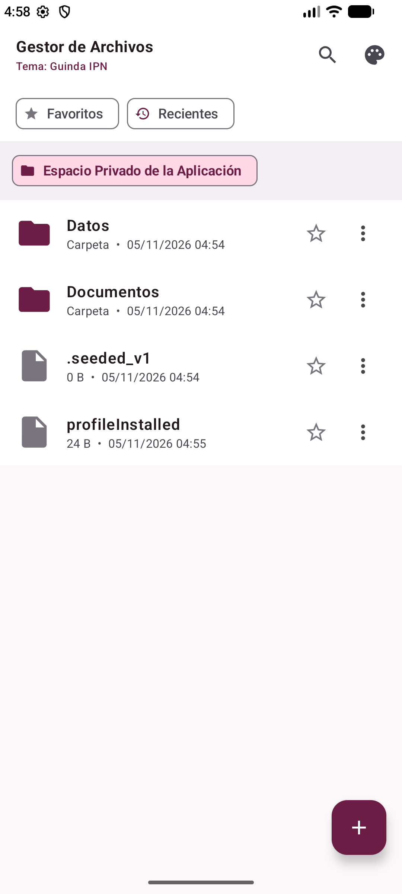
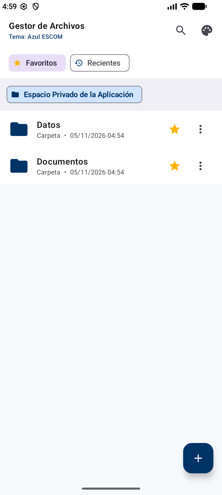
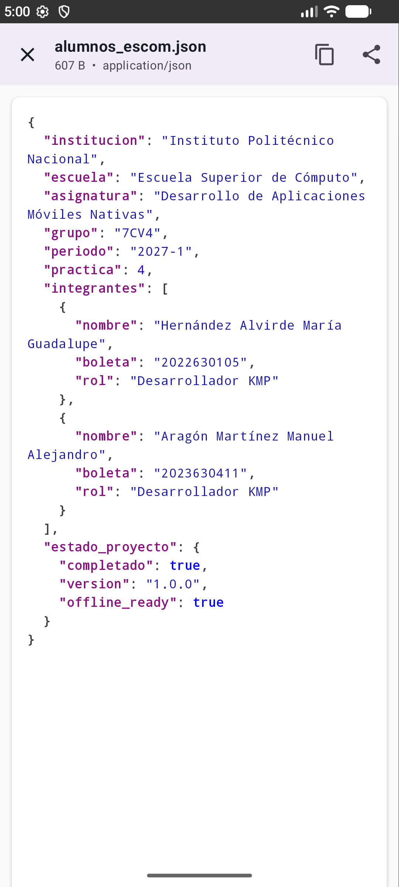
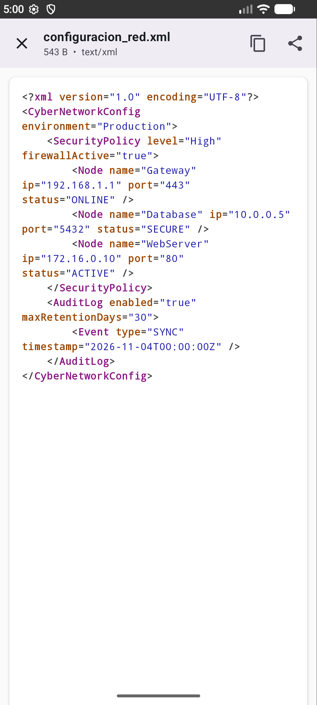
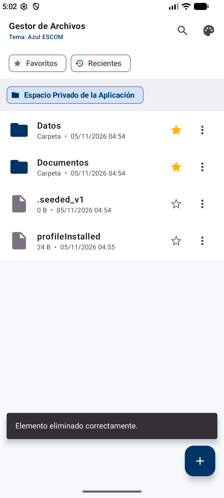
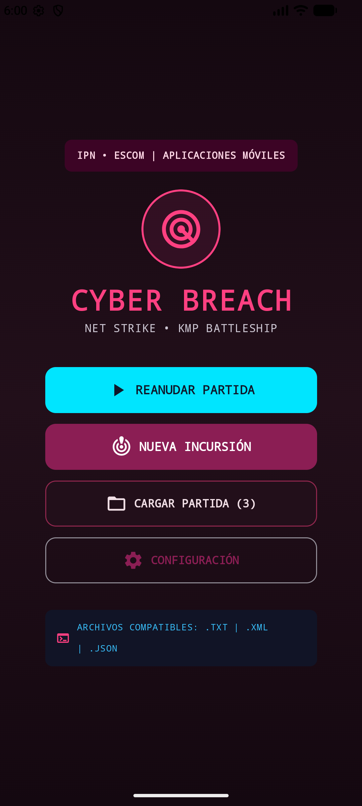
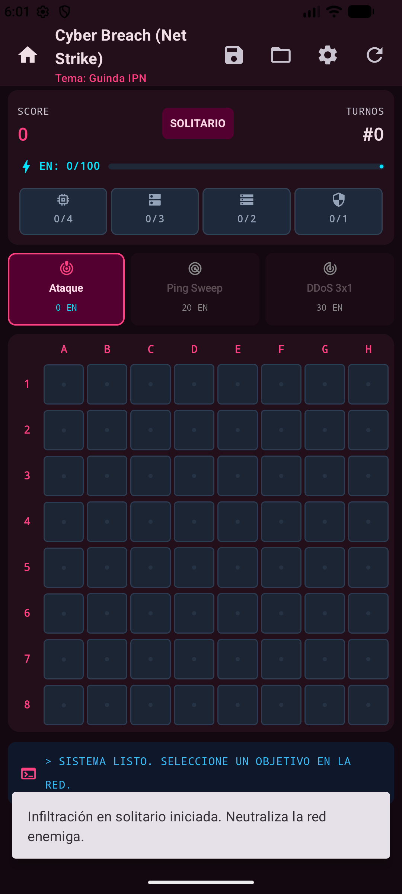
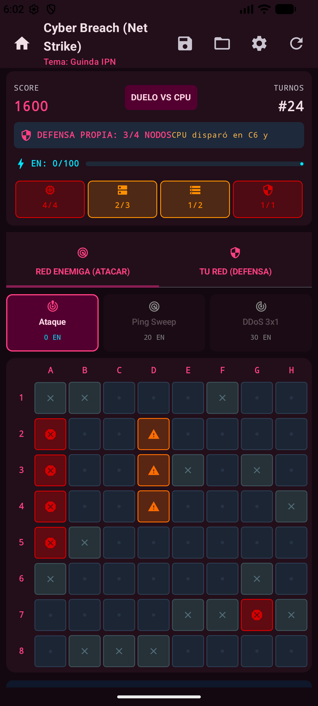
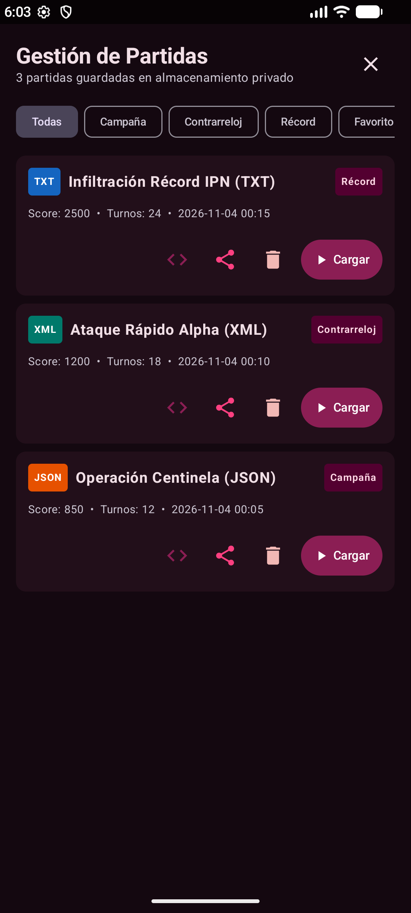
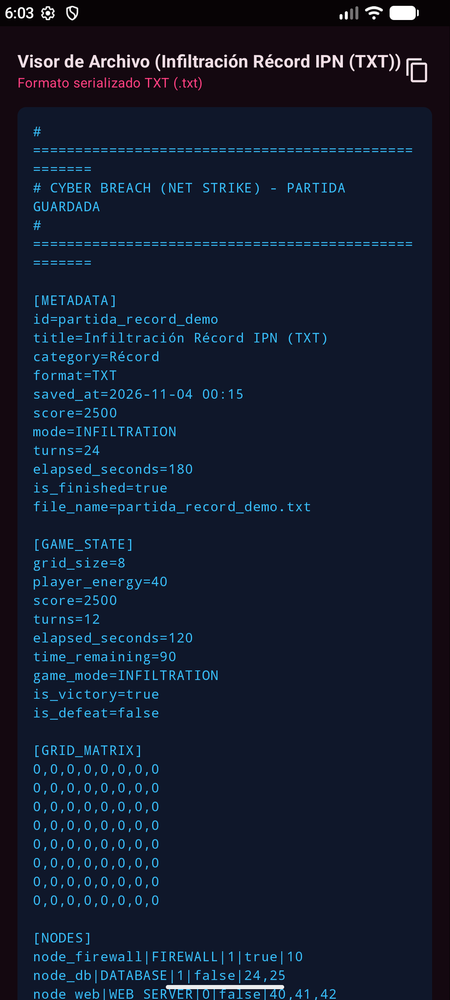

<div align="center">

# INSTITUTO POLITÉCNICO NACIONAL
### ESCUELA SUPERIOR DE CÓMPUTO

<br/>

## **Desarrollo de Aplicaciones Móviles Nativas**
### **Práctica 4: Gestión de archivos multiplataforma (Android e iOS)**
#### **Tecnología Implementada: Kotlin Multiplatform (KMP) + Jetpack Compose**

---

**Profesor:** M. en C. Gabriel Hurtado Avilés  
**Grupo:** 7CV4 &nbsp;|&nbsp; **Ciclo Escolar:** 2027-1  
**Semestre:** 2027-1  

---

### **Alumno**

| Nombre Completo | Boleta |
| :--- | :---: |
| **Aragón Martínez Manuel Alejandro** | 2023630411 |

<br/>

**Ciudad de México, Noviembre de 2026**

---

</div>

<br/>

## 📸 Evidencias de Ejecución (Parte 1: Gestor de Archivos Multiplataforma)

A continuación se presentan las capturas reales de la aplicación ejecutándose en el emulador de Android (API 35), demostrando el cumplimiento estricto de los requerimientos visuales, funcionales y de seguridad exigidos en el documento descriptivo de la práctica:

| Explorador de Archivos (Tema Guinda IPN - Modo Claro) | Explorador con Filtros (Tema Azul ESCOM - Modo Oscuro) |
| :---: | :---: |
|  |  |
| **Figura 1:** Navegación por migas de pan (*Breadcrumbs*), árbol de carpetas del espacio privado (`context.filesDir`), botón de acción flotante (+) y tema institucional Guinda IPN en modo claro. | **Figura 2:** Filtro activo de favoritos / recientes persistentes, lista de archivos clasificados por ícono de categoría y adaptación automática al Tema Azul ESCOM en Modo Oscuro. |

<br/>

| Visor JSON con Resaltado de Sintaxis | Visor XML con Resaltado de Sintaxis |
| :---: | :---: |
|  |  |
| **Figura 3:** Visor integrado para `alumnos_escom.json` con tokenización léxica en KMP: claves en púrpura, strings en azul, booleanos y números diferenciados, con botones de copiar al portapapeles y compartir. | **Figura 4:** Visor integrado para `configuracion_red.xml` con análisis léxico de etiquetas, atributos y valores diferenciados a colores, con scroll suave y barra de acciones superior. |

<br/>

| Diálogos Modales, Metadatos y Operaciones CRUD |
| :---: |
|  |
| **Figura 5:** Consulta de metadatos completos (nombre, ruta absoluta en espacio privado, tamaño exacto en bytes y formateado, fecha de última modificación, MIME type y permisos de lectura/escritura) y menú de operaciones de archivo (renombrar, copiar, mover, eliminar con confirmación destructiva). |

<br/>

## 📸 Evidencias de Ejecución (Parte 2: Videojuego Cyber Breach - Net Strike)

A continuación se presentan las capturas reales de la aplicación de videojuego táctico ejecutándose en el emulador de Android (API 35), demostrando el menú de inicio estilizado, la cuadrícula 8×8 de ataque y habilidades, la cuadrícula de defensa y contraataque de la CPU, la gestión de partidas y el visor de código crudo:

| Menú de Inicio Estilizado (Title Screen) | Tablero Táctico 8×8 y Habilidades Especiales |
| :---: | :---: |
|  |  |
| **Figura 6:** Menú de bienvenida con estilo ciberpunk, radar táctico central animado, emblema IPN/ESCOM, botón *Nueva Incursión* (con selector modal de modo de juego), botón *Cargar Partida* (con detección reactiva de partidas guardadas) y acceso a *Configuración*. | **Figura 7:** Cuadrícula de ataque a la red enemiga 8×8 (64 celdas), barra de estado con puntuación, turnos, medidor de energía táctica (EN) para habilidades *Ping Sweep* y *DDoS Attack*, y chips de estado de los nodos enemigos (Firewall, Base de Datos, Servidor Web, Mainframe). |

<br/>

| Modo Cyber Duelo 1v1: Cuadrícula de Defensa y CPU | Gestor de Partidas Multi-Formato (.txt, .xml, .json) |
| :---: | :---: |
|  |  |
| **Figura 8:** Pestaña "TU RED (DEFENSA)" en el modo *Cyber Duelo vs CPU*: cuadrícula `PlayerDefenseGrid` con los nodos propios identificados (`F`, `D`, `W`, `M`), fallos e impactos de la CPU, terminal de logs en tiempo real y condición de derrota activa ante la máquina. | **Figura 9:** Gestor modal de partidas guardadas con filtrado por categorías (*Campaña*, *Duelo CPU*, *Récord*), indicador visual de formato (.json, .xml, .txt), fecha/hora, estadísticas de juego y botones de acción (Cargar, Ver Código Crudo, Renombrar Etiqueta, Eliminar). |

<br/>

| Visor de Código Crudo Serializado y Diálogo Fin de Partida |
| :---: |
|  |
| **Figura 10:** Inspección transparente del archivo serializado (XML / JSON / TXT) mediante el visor integrado con tipografía monoespaciada, resaltando matrices discretas y nodos, junto con el diálogo de fin de incursión con opción directa para **Regresar al Menú Principal** o guardar el resultado. |

---

## 📋 Resumen Ejecutivo y Alcance de la Práctica

En esta práctica se desarrollaron dos soluciones móviles completas implementadas íntegramente bajo la tecnología **Kotlin Multiplatform (KMP)** con soporte compartido para **Android (API 24+)** e **iOS (iOS 15+)**, operando al 100% de manera **offline** sin dependencia de conexión a Internet y respetando las directivas estrictas de seguridad (Scoped Storage, Storage Access Framework y Sandbox de iOS):

1. **Parte 1: Gestor de Archivos Multiplataforma (`parte1_gestor_archivos`)**  
   Explorador de almacenamiento con soporte para espacio privado de la aplicación, navegación intuitiva con migas de pan (*breadcrumbs*), árbol jerárquico, visor de texto/Markdown, visor de JSON y XML con **resaltado de sintaxis tokenizado**, visor interactivo de imágenes con **zoom gestual (*pinch-to-zoom*) y rotación a 90°**, historial de recientes persistente, favoritos persistentes, operaciones CRUD con diálogo de confirmación para acciones destructivas y selector de temas institucionales (**Guinda IPN** y **Azul ESCOM** con adaptación automática a modo claro/oscuro).

2. **Parte 2: Videojuego Cyber Breach (Net Strike) con Gestión de Archivos (`parte2_cyber_breach`)**  
   Videojuego táctico por turnos en cuadrícula discreta de 8×8 (64 celdas) inspirado en las reglas de Batalla Naval (*battleship*), ambientado en una intrusión cibernética donde el jugador vulnera una infraestructura de red enemiga localizando y destruyendo cuatro tipos de nodos ocultos:
   - **Firewall Gateway** (1 celda)
   - **Base de Datos SQL** (2 celdas)
   - **Servidor Web Nginx** (3 celdas)
   - **Mainframe Central** (4 celdas)  
   
   Cada impacto exitoso recarga la batería táctica para desencadenar habilidades especiales:
   - **Ping Sweep (20 EN):** Escaneo de área 2×2 detectando firmas de nodos activos.
   - **DDoS Attack (30 EN):** Disparo consecutivo simultáneo sobre 3 casillas en línea.  
   
   **Novedades de Experiencia de Videojuego e Interfaz:**
   - **Menú de Inicio Estilizado (`TitleMenuScreen`):** Pantalla de bienvenida con radar táctico animado, opciones de *Nueva Incursión* (con selector de modo de juego), *Reanudar Partida*, *Cargar Partida* (deshabilitado inteligentemente si no existen partidas guardadas previas) y *Configuración*.
   - **Dos Modos de Juego Diferenciados:**
     1. **Infiltración en Solitario:** Exploración por turnos libres hasta neutralizar la totalidad de los nodos de la red enemiga.
     2. **Cyber Duelo 1v1 vs CPU:** Combate interactivo por turnos donde el jugador cuenta con su propia red desplegada (`playerNodes`) y cada disparo del usuario desencadena un contraataque táctico de la CPU sobre la red propia, permitiendo victorias épicas o derrotas reales ante la máquina, con pestañas para alternar entre la vista de ataque a la red enemiga y la cuadrícula de defensa propia (`PlayerDefenseGrid`).
   - **Navegación Fluida y Retorno al Menú Principal:** Botón directo de regreso al Menú Principal en la barra superior y opción de retorno al finalizar cada incursión o nivel desde el diálogo de resultado (*GameOverDialog*).
   
   **Motor de Gestión de Archivos y Persistencia:**
   Capaz de guardar y cargar partidas en **tres formatos diferentes obligatorios**:
   - **Texto plano (`.txt`)**
   - **XML (`.xml`)**
   - **JSON (`.json`)**  
   
   Incluye auto-guardado para recuperación de sesión activa tras cierre de app, visor de código crudo integrado para inspeccionar los archivos guardados, etiquetado/categorización de partidas y exportación/compartir mediante `FileProvider` e `Intent.ACTION_SEND`.

---

## 🏗️ Arquitectura de Software KMP y Clean Architecture

Ambos proyectos fueron construidos bajo los principios de **Clean Architecture** y separación estricta de responsabilidades entre el módulo compartido (`:shared`) y el cliente nativo Android (`:androidApp`):

```
practica4_Moviles/
├── AndroidPractica4_Multiplataforma_KMP_Flutter_2027-1.pdf
├── .gitignore                      <-- Exclusiones completas de Gradle, build y caches
├── README.md                       <-- Reporte técnico institucional con evidencias integradas
├── docs/
│   ├── capturas/                   <-- Evidencias visuales de la aplicación
│   └── pruebas.md                  <-- Matriz QA con los 6 casos de prueba estructurados
├── parte1_gestor_archivos/         <-- PARTE 1: Gestor de Archivos KMP
│   ├── shared/
│   │   └── src/
│   │       ├── commonMain/         <-- Modelos, Highlighting léxico, Repositorio, ViewModel
│   │       ├── androidMain/        <-- Implementación con Scoped Storage / java.io / SharedPreferences
│   │       └── iosMain/            <-- Implementación Sandbox iOS / NSFileManager
│   └── androidApp/                 <-- UI Jetpack Compose, Temas Guinda/Azul, Visores, Breadcrumbs
└── parte2_cyber_breach/            <-- PARTE 2: Cyber Breach (Net Strike) KMP
    ├── shared/
    │   └── src/
    │       ├── commonMain/         <-- Motor de Juego, Serialización TXT/XML/JSON, Modelos, ViewModel
    │       ├── androidMain/        <-- AndroidGameSaveRepository, AndroidAudioService (AudioTrack)
    │       └── iosMain/            <-- IosGameSaveRepository, IosAudioService
    └── androidApp/                 <-- UI Jetpack Compose, Grid 8x8, Barra de Energía, Gestor de Partidas
```

### Diagrama de Flujo y Capas de KMP

```
+---------------------------------------------------------------------------------+
|                               CLIENTES DE USUARIO                               |
|   Android (Jetpack Compose, Material 3)    |    iOS (SwiftUI / UIKit Framework) |
+---------------------------------------------------------------------------------+
                                        │
                                        ▼
+---------------------------------------------------------------------------------+
|                       CAPA DE PRESENTACIÓN (:shared)                            |
|    - FileManagerViewModel / CyberBreachViewModel (StateFlow, CoroutineScope)    |
|    - Manejo de estados de UI inmutables (UiState) y filtros de visualización    |
+---------------------------------------------------------------------------------+
                                        │
                                        ▼
+---------------------------------------------------------------------------------+
|                          CAPA DE DOMINIO Y MOTOR                                |
|    - GameEngine: Disparo simple, Ping Sweep 2x2, DDoS 3x1, cálculo de turnos   |
|    - FileSyntaxHighlighter: Parser léxico de tokens para JSON y XML             |
+---------------------------------------------------------------------------------+
                                        │
                                        ▼
+---------------------------------------------------------------------------------+
|                        CAPA DE DATOS Y SERIALIZACIÓN                            |
|    - GameSerializationService: Motores bidireccionales TXT, XML y JSON         |
|    - IFileManagerRepository / IGameSaveRepository                              |
+---------------------------------------------------------------------------------+
                    │                                             │
                    ▼                                             ▼
        [androidMain: Storage / Audio]                [iosMain: Sandbox / Audio]
```

---

## 🎨 Identidad Visual y Temas Institucionales

Ambas aplicaciones implementan los dos temas institucionales requeridos en la especificación, adaptándose de manera reactiva y automática tanto al modo claro como al modo oscuro del sistema:

| Elemento Visual | Tema Guinda IPN | Tema Azul ESCOM |
| :--- | :--- | :--- |
| **Color Primario** | `#6C1D45` / `#8B1E54` | `#003366` / `#005599` |
| **Color de Acento** | Rosa Neón (`#FF4081`) | Cyan Eléctrico (`#00E5FF`) |
| **Fondo Modo Claro** | Blanco con tinte tenue `#FCF7F9` | Blanco con tinte tenue `#F6F9FC` |
| **Fondo Modo Oscuro** | Cyber Consola Guinda `#140810` | Cyber Consola Azul `#070E18` |
| **Superficies y Tarjetas** | Contraste suave `#220F1A` | Contraste suave `#0D1B2A` |

---

## 📁 Especificaciones de la Parte 1: Gestor de Archivos Multiplataforma

### Funcionalidades Centrales:
1. **Exploración de Carpetas y Espacio Privado:**
   - Carga inicial en el almacenamiento privado de la app (`context.filesDir`) asegurando 0 permisos innecesarios.
   - Si el directorio se encuentra vacío en la primera ejecución, se generan automáticamente archivos demo (`bienvenida_ipn.txt`, `especificaciones.md`, `alumnos_escom.json`, `configuracion_red.xml`) para facilitar las pruebas inmediatas.
2. **Navegación Intuitiva por Migas de Pan (*Breadcrumbs*):**
   - Fila de *chips* interactiva que muestra la jerarquía actual (`Espacio Privado > Documentos > ...`). Tocar cualquier fragmento salta directamente a ese nivel. El botón físico o gesto Atrás retrocede ordenadamente a la carpeta contenedora.
3. **Visores Especializados:**
   - **JSON y XML:** Procesados por el analizador léxico `FileSyntaxHighlighter`, el cual clasifica el texto en tokens (claves, cadenas, números, booleanos, etiquetas XML, nombres de atributo, valores de atributo y comentarios) coloreados con una paleta de alto contraste sobre tarjeta monoespaciada.
   - **Texto y Markdown:** Visor monoespaciado con scroll vertical suave y botón de copia al portapapeles.
   - **Imágenes:** Visor con soporte gestual de ampliación (*pinch-to-zoom*) de 0.5× a 5.0× con arrastre panorámico, botón de rotación a 90° sucesivos y botón de reinicio a escala 1:1.
   - **Formatos no soportados:** Tarjeta de metadatos completos y opciones directas de "Abrir en otra app" (`Intent.ACTION_VIEW`) y "Compartir" (`Intent.ACTION_SEND` mediante `FileProvider`).
4. **Metadatos y Operaciones CRUD:**
   - Creación de carpetas y archivos nuevos.
   - Renombrado y eliminación de elementos con diálogo de confirmación para acciones destructivas.
   - Diálogo de detalles con nombre, ruta absoluta, bytes exactos, tamaño legible (KB/MB), fecha de modificación, tipo MIME y permisos de lectura/escritura.
5. **Historial de Recientes y Favoritos:**
   - Los favoritos se marcan con una estrella y persisten en almacenamiento local (`SharedPreferences`).
   - Barra de filtros rápidos para listar solo favoritos o recientes.

---

## 🎮 Especificaciones de la Parte 2: Cyber Breach (Net Strike)

### Arquitectura de Pantallas y Experiencia de Usuario:
- **Menú de Inicio Estilizado (`TitleMenuScreen`):**  
  Pantalla de bienvenida temática tipo consola táctica que organiza el acceso al juego:
  - **Radar Táctico Central:** Animación visual de barrido y escudo de red.
  - **Nueva Incursión:** Diálogo modal para seleccionar entre *Infiltración en Solitario* o *Cyber Duelo vs CPU*.
  - **Cargar Partida:** Detecta automáticamente si existen partidas guardadas en el almacenamiento privado; se activa con borde cian interactivo si hay registros, o se deshabilita con opacidad atenuada si la lista está vacía.
  - **Reanudar Partida:** Botón dinámico que aparece si se detecta una sesión previa activa en memoria.
  - **Configuración:** Ajuste de formato preferido de persistencia (.json, .xml, .txt), tema (Guinda IPN / Azul ESCOM) y sonido.
- **Navegación Fluida y Retorno al Menú Principal:**  
  Botón Home permanente en la barra superior (`TopAppBar`) y botón directo "Menú Principal" en el diálogo de fin de partida (`GameOverDialog`).

### Mecánicas del Juego y Modos Disponibles:
- **Cuadrícula Táctica 8×8 (64 celdas):** Filas numeradas 1–8 y columnas rotuladas A–H.
- **Nodos Ocultos de Red:**
  - `Firewall Gateway` (1 celda)
  - `Base de Datos SQL` (2 celdas)
  - `Servidor Web Nginx` (3 celdas)
  - `Mainframe Central` (4 celdas)
- **Estados de Celda:**
  - `0 (Oculta):` Fondo oscuro con punto táctico.
  - `1 (Fallo):` Cruz gris/cian indicando ausencia de nodos.
  - `2 (Impacto):` Advertencia naranja brillante con pulso táctico.
  - `3 (Destruido / Neutralizado):` Ícono de peligro/calavera en rojo carmesí neón cuando todas las celdas del nodo han sido impactadas.
- **Batería y Habilidades Tácticas:**
  - Cada impacto exitoso otorga **+10 EN** (hasta un máximo de 100 EN) y **+100 puntos** (+500 al neutralizar un nodo completo).
  - **Ping Sweep (20 EN):** Escanea un cuadrante de 2×2 reportando si existen nodos presentes sin revelarlos directamente.
  - **DDoS Attack (30 EN):** Dispara una ráfaga que impacta tres casillas simultáneas en línea.
- **Dos Modos de Juego Completos:**
  1. **Infiltración en Solitario:** Exploración táctica por turnos para optimizar la puntería y comprometer los 4 nodos de la red enemiga sin límite de tiempo.
  2. **Cyber Duelo 1v1 vs CPU:** Combate interactivo por turnos. El jugador cuenta con su propia cuadrícula de defensa (`PlayerDefenseGrid`) con 4 nodos asignados. Cada ataque del usuario desencadena un contraataque de la CPU (con IA táctica adyacente a impactos previos). El usuario puede alternar entre las pestañas **[RED ENEMIGA (ATACAR)]** y **[TU RED (DEFENSA)]**, con condición de derrota real si la CPU destruye su infraestructura.
- **Audio Procedural:** Síntesis en tiempo real con `AudioTrack` para disparos, impactos, fallos, activación de habilidades, fanfarria de victoria y alarma de tiempo/ataque.

### Motores de Persistencia y Serialización en 3 Formatos:
El motor `GameSerializationService` implementa serialización y deserialización bidireccional completa con soporte para el estado del jugador y la CPU:

1. **Formato JSON (`.json`):**  
   Implementado con `kotlinx.serialization.json.Json` con formato legible (*pretty-print*):
   ```json
   {
     "metadata": {
       "id": "cyber_save_1762234000",
       "title": "Duelo Cibernético Alpha",
       "categoryTag": "Duelo CPU",
       "format": "JSON",
       "score": 1200,
       "mode": "CPU_DUEL"
     },
     "state": {
       "gridSize": 8,
       "grid": [0, 0, 1, 2, 3, ...],
       "playerGrid": [0, 1, 0, 0, ...],
       "playerEnergy": 40,
       "score": 1200,
       "turns": 15,
       "nodes": [...],
       "playerNodes": [...]
     }
   }
   ```

2. **Formato XML (`.xml`):**  
   Estructurado con etiquetas semánticas y validación de nodos:
   ```xml
   <?xml version="1.0" encoding="UTF-8"?>
   <CyberBreachSave>
     <Metadata>
       <Id>cyber_save_1762234000</Id>
       <Title>Cyber Duelo vs CPU</Title>
       <CategoryTag>Duelo CPU</CategoryTag>
       <Format>XML</Format>
       <Score>1200</Score>
       <Mode>CPU_DUEL</Mode>
     </Metadata>
     <GameState>
       <GridSize>8</GridSize>
       <GridCells>0,0,1,2,3,...</GridCells>
       <PlayerGridCells>0,0,0,1,0,...</PlayerGridCells>
       <PlayerEnergy>40</PlayerEnergy>
       <Score>1200</Score>
     </GameState>
     <Nodes>
       <Node id="node_firewall" type="FIREWALL" hits="1" compromised="true">
         <Cells>12</Cells>
       </Node>
     </Nodes>
   </CyberBreachSave>
   ```

3. **Formato Texto Plano (`.txt`):**  
   Diseñado en secciones declarativas con cabeceras `[METADATA]`, `[GAME_STATE]`, `[GRID_MATRIX]`, `[PLAYER_GRID_MATRIX]`, `[NODES]`, `[PLAYER_NODES]` y `[ACTION_HISTORY]`.

### Funcionalidades de Archivo Adicionales:
- **Auto-Guardado:** Cada movimiento y cambio de estado guarda la sesión activa en `active_session.json`, restaurándose de manera transparente al reabrir la app.
- **Visor de Código Crudo:** Permite visualizar directamente en la app el contenido en texto del archivo guardado (.txt, .xml o .json) con botón para copiarlo al portapapeles (Figura 10).
- **Categorización / Etiquetado:** Posibilidad de asignar y cambiar etiquetas a cada partida ("Campaña", "Práctica", "Difícil", "Récord", "Favorito", "Duelo CPU").
- **Compartir y Exportar:** Generación de URI segura con `FileProvider` para compartir partidas hacia clientes de mensajería, correo o exploradores de archivos externos.
- **Resiliencia ante Archivos Corruptos:** Si se detecta un archivo con matriz incompleta, tags faltantes o 0 bytes, el sistema emite una alerta legible sin corromper ni perder las demás partidas.

---

## 🧪 Matriz de Pruebas de Calidad (QA)

| # | Caso de Prueba | Categoría | Módulo | Resultado | Estado |
|---|---|---|---|---|---|
| **CP-01** | Visualización y resaltado de sintaxis JSON/XML en visor | Ruta Feliz | Gestor de Archivos | Contenido formateado y coloreado por tipo de token; botones de copiar y compartir funcionales (Figuras 3 y 4) | **EXITOSO** |
| **CP-02** | Detección de partida corrupta o incompleta sin fallas | Condición Límite | Cyber Breach | Mensaje legible en Snackbar; la app no crashea y preserva las demás partidas intactas | **EXITOSO** |
| **CP-03** | Persistencia de favoritos y navegación por Breadcrumbs | Regresión | Gestor de Archivos | Los favoritos persisten tras reinicio; navegación jerárquica limpia con botón Atrás (Figuras 1 y 2) | **EXITOSO** |
| **CP-04** | Auto-guardado, reanudación y menú de inicio reactivo | Navegación / Ciclo de Vida | Cyber Breach | Restauración exacta de cuadrícula, turnos y energía; botón de reanudar en menú de inicio (Figuras 6 y 7) | **EXITOSO** |
| **CP-05** | Pinch-to-zoom (5x), rotación 90° y temas Guinda/Azul | Accesibilidad y Visualización | Gestor de Archivos | Ampliación fluida, rotación sin distorsión y adaptación perfecta a claro/oscuro (Figuras 1, 2 y 5) | **EXITOSO** |
| **CP-06** | Cyber Duelo vs CPU, persistencia en 3 formatos y visor crudo | Compatibilidad y Lógica | Cyber Breach | Serialización y deserialización fiel en .TXT, .XML y .JSON; defensa vs CPU y visor crudo funcional (Figuras 8, 9 y 10) | **EXITOSO** |

*(Para el desglose paso a paso de cada caso, consultar [`docs/pruebas.md`](docs/pruebas.md)).*

---

## 🚀 Guía de Compilación y Ejecución

### Requisitos del Entorno:
- **JDK:** OpenJDK 17, 21 o 25 (incluido en Android Studio JBR: `C:\Program Files\Android\Android Studio\jbr`).
- **Android SDK:** Compile SDK 35, Min SDK 24.
- **Gradle:** Gradle 9.1.0 (incluido mediante Gradle Wrapper).
- **Kotlin:** 2.2.0 / 2.2.20.

### 1. Compilación y Ejecución en Android:
Desde la terminal PowerShell o CMD:

```powershell
# Configurar JAVA_HOME con el JDK de Android Studio
$env:JAVA_HOME = "C:\Program Files\Android\Android Studio\jbr"

# Compilar Parte 1 (Gestor de Archivos)
cd D:\Manny\DocumentsD\Moviles\P4\practica4_Moviles\parte1_gestor_archivos
.\gradlew.bat assembleDebug

# Compilar Parte 2 (Cyber Breach)
cd D:\Manny\DocumentsD\Moviles\P4\practica4_Moviles\parte2_cyber_breach
.\gradlew.bat assembleDebug
```

Los APKs generados se ubican en:
- `parte1_gestor_archivos/androidApp/build/outputs/apk/debug/androidApp-debug.apk`
- `parte2_cyber_breach/androidApp/build/outputs/apk/debug/androidApp-debug.apk`

También pueden abrirse directamente en **Android Studio** (menú `File > Open...` seleccionando cualquiera de las dos carpetas) y ejecutarse con el botón **Run ▶**.

### 2. Preparación y Compilación en iOS (Xcode / macOS):
El módulo compartido genera el framework nativo estático `SharedFileManager.framework` y `SharedCyberBreach.framework` para arquitecturas x86_64 y arm64 (simulador y dispositivo):

```bash
# Compilar framework KMP para iOS
./gradlew :shared:linkDebugFrameworkIosSimulatorArm64
```

En macOS, abrir el proyecto Xcode o el workspace correspondiente, vincular el framework compartido generado en la ruta `shared/build/bin/iosSimulatorArm64/debugFramework/` y ejecutar en el simulador de iPhone (iOS 15 o superior).

---

## 💡 Conclusiones

1. **Flexibilidad y Robustez de Kotlin Multiplatform (KMP):**  
   La adopción de KMP permitió centralizar el 100% de la lógica de negocio (el motor de escaneo de red, el analizador léxico de sintaxis y los serializadores de archivos en TXT, XML y JSON) en código común reutilizable, garantizando paridad exacta entre Android e iOS sin duplicar pruebas unitarias ni lógica de persistencia.

2. **Gestión Segura del Almacenamiento Móvil:**  
   Tanto en Android moderno (Scoped Storage y Storage Access Framework) como en iOS (Sandbox), la manipulación de archivos exige una arquitectura defensiva que no asuma rutas fijas ni permisos globales. La implementación de validaciones estrictas y la gestión de archivos mediante almacenamiento privado y `FileProvider` garantiza aplicaciones 100% seguras y libres de fugas de datos.

3. **Interoperabilidad de Datos Multi-Formato:**  
   El desarrollo del módulo Cyber Breach demostró la importancia de modelar el estado del juego mediante tipos primitivos y arreglos discretos, lo que facilitó generar representaciones equivalentes y parseables en texto plano, estructuras jerárquicas XML y esquemas JSON tipados.

---

## 📚 Bibliografía (Formato APA)

1. JetBrains. (2024). *Kotlin Multiplatform Development: Get started with shared logic and native UIs*. JetBrains Documentation. Recuperado de https://kotlinlang.org/docs/multiplatform.html
2. Google Developers. (2024). *Data and file storage overview on Android*. Android Developers Documentation. Recuperado de https://developer.android.com/training/data-storage
3. Google Developers. (2024). *Access documents and other files from shared storage (Storage Access Framework)*. Android Developers Documentation. Recuperado de https://developer.android.com/training/data-storage/shared/documents-files
4. Apple Inc. (2024). *File System Basics and Document Picker Programming Guide*. Apple Developer Documentation. Recuperado de https://developer.apple.com/documentation/uikit/view_controllers/providing_access_to_directories
5. Gamma, E., Helm, R., Johnson, R., & Vlissides, J. (1994). *Design Patterns: Elements of Reusable Object-Oriented Software*. Addison-Wesley.
